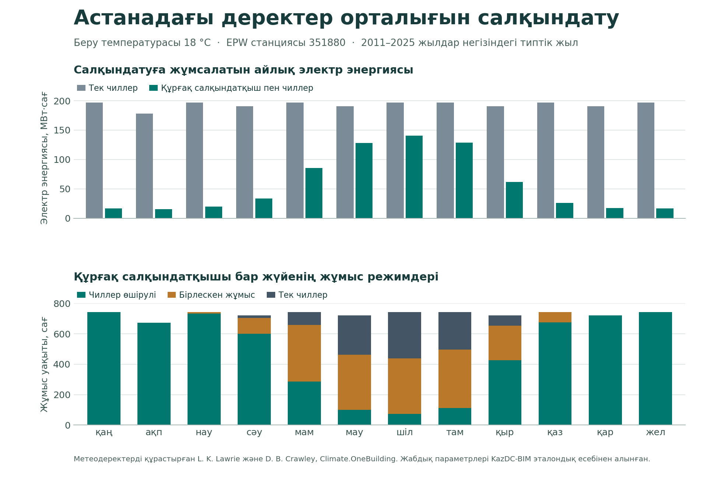

# KazDC энергетика технологиялары

[English](README.md) · Қазақша · [Русский](README.ru.md) · [简体中文](README.zh.md)

[Интерактивті платформаны ашу](https://ktwyw.github.io/kazdc-energy-tech/regional-kk.html) · [Қазақстандағы зерттеу басымдықтары](https://ktwyw.github.io/kazdc-energy-tech/research-priorities-kk.html) · [Кездесуге арналған бір беттік анықтама (PDF)](reference/KazDC_Research_Brief_KK.pdf)

**Жобаны ұсынған ұйым** — [INMET](https://inmet.nu.edu.kz/kz), Жаңа материалдар және энергетикалық технологиялар институты, Назарбаев Университеті. **Байланыс тұлғасы** — Янвей Ванг, PhD · [yanwei.wang@nu.edu.kz](mailto:yanwei.wang@nu.edu.kz).

KazDC энергетика технологиялары — Қазақстандағы деректерді өңдеу орталықтарының энергия тиімділігін зерттеуге арналған KazDC-BIM интерактивті модельдеу платформасы. Оны интернетсіз пайдалануға болады. Бір қондырғының жұмысын 21 қаланың жарияланған метеодеректері бойынша есептеп, нәтижелерді салыстыра аласыз. Технологиялық зерттеулерде есептелген энергия ағындары студенттер мен инженерлер өлшей алатын шамалармен байланыстырылады.

Жобаны архивтен шығарып, [басты бетті](regional-kk.html) браузерде ашыңыз. Есептеулер құрылғыңызда орындалады, қажет метеодеректер жобаға енгізілген. Басты бетте салқындатуға жұмсалатын жылдық электр энергиясы және чиллерді өшіруге болатын сағат саны көрсетілген. Қарды сақтау, бөлінген жылуды пайдалану және үздіксіз қуат көзіндегі (UPS) шығындар бойынша есеп мысалдары берілген. Айлық орташа ауа температурасын салыстыру графигі [метеостанция архивтерінің](references-kk.html#weather-comparison) жанында орналасқан. Салқындату мен жылуды пайдалану модельдері Қазақстанның 17 облыс орталығын және Астана, Алматы, Шымкент пен Екібастұз қалаларын қамтиды. Әр қала үшін 8 760 сағаттан тұратын жеке типтік жыл алынған. Түсіндірмеде бастапқы деректер кезеңі, метеостанция немесе реанализ нүктесі және бастапқы архив көрсетілген. [Аймақтық метеодеректер](data/regions/README.kk.md)

Барлық он бөлім ағылшын, қазақ, орыс және қытай (жеңілдетілген жазу) тілдерінде қолжетімді. Беттің жоғарғы жағындағы **Тіл** мәзірі сол бөлімнің басқа тілдегі нұсқасын ашады. Қалалар бойынша есептеуде модельденетін қала, ауа райы салыстырылатын қала және контурға берілетін сұйықтың температурасы сақталады.

Басты бетте беру температурасын 24 °C етіп таңдап, таңдалған қала үшін шілдедегі нәтиженің қалай өзгеретінін көріңіз. [Екі қаланы ай сайын салыстыру](regional-kk.html#city-comparison) бөлімінде екі қалаға ортақ беру температурасын орнатып, екі қаланың да деректерін жүктеп алуға болады. Есепті көшіру түймесі модель параметрлерін, нұсқасын және жалпыға қолжетімді сілтемені көшіреді. Енгізілген өлшем нәтижелері браузердің осы қойындысында қалады.

| Зерттеу | Не істеуге болады? | Есептеу шекарасы |
|---|---|---|
| [Қазақстандағы зерттеу басымдықтары](research-priorities-kk.html) | Екібастұздың шілде айындағы екі беру температурасын салыстырып, бір оператормен жүргізуге болатын зерттеуді қарастыру | [Кездесуге арналған бір беттік анықтама](reference/KazDC_Research_Brief_KK.pdf) мамандардың уақытын, өлшеулерді және модельді тексеруді қамтиды |
| [Қалалар бойынша салқындату](regional-kk.html#compare) | Таңдалған беру температурасында 21 қала үшін салқындатуға жұмсалатын электр энергиясы мен чиллер жұмыс істемейтін сағат санын салыстыру, жылдық немесе айлық нәтижелерді жүктеу. | 1 МВт тұрақты IT жүктемесінде чиллердің, құрғақ салқындатқыш желдеткішінің және контур сорғысының электр тұтынуы |
| [Астанадағы эталондық қондырғы](astana-kk.html) және [есептеу әдісі](methods-kk.html) | Температураның 49 берілген мәнін зерттеу және нақты бір сағаттағы жұмыс режимінің қалай таңдалғанын тексеру | Астанаға арналған егжей-тегжейлі эталондық есеп |
| [Қарды маусымдық салқындатуға пайдалану](snow-kk.html) | Қойма көлемін таңдау, қорды жұмсаудың екі тәртібін салыстыру және 5 кВт жүктемедегі жеті тәуліктік жеке модельді қайта есептеу | Астанада қар сақтау сценарийі және құжаттамасы бөлек берілген сандық эталон |
| [Жылуды қайта пайдалану](heat-kk.html) | Жылуды тікелей немесе жылу сорғысы арқылы беру мүмкіндігін шартты ғимараттың ауа райына тәуелді қажеттілігімен салыстыру | Ғимаратқа берілген жылу, IT жабдығынан алынған жылу және компрессор жұмысы бөлек есептеледі |
| [UPS шығындары](power-kk.html) | IT жабдығына бірдей қуат бергенде екі жұмыс тиімділігін салыстыру | UPS кірісі мен шығысындағы электр қуаты |
| [Дереккөздер](references-kk.html) | Метеодеректердің, теңдеулердің және эксперимент әдістерінің жарияланған дереккөздерін табу | Станция архивтері, жоба жорамалдары және эталондық нәтижелер |
| [Су контурындағы тәжірибе](bench-kk.html) | Болжам мен белгілі бір аралықтағы өлшемдерді енгізіп, энергия теңгерімінің таңбалы қалдығын жүктеу | Тұрақталған режимдегі сұйық су контурының сынақ бөлігі, белгіленген мысал және нақты өлшеуге арналған бос кесте |
| [Адиабаталық алдын ала салқындату](technologies-kk.html?study=pad) | Жазғы су қорын, ылғалдандырғыш төсемнің тиімділігін және сыртқы ауа бойынша қосылу шегін орнату | Ылғал термометр температурасы бойынша сағаттық шек, толықтыру суы, сорғы мен желдеткіштің қуаты және чиллерді өшіруге болатын қосымша толық сағаттар |
| [Чипті тікелей салқындататын пластиналар](technologies-kk.html?study=cold) | Дайын мысалды пайдалану немесе қыздырғыш пен су контурында өлшенген шамаларды енгізу | Сұйық әкеткен жылу, пластина мен кіріс сұйығы арасындағы жылулық кедергі және пластинадағы қысым түсуін еңсеруге қажет сорғы қуаты |
| [Сыртқы ауамен жанама салқындату](technologies-kk.html?study=air) | Ауа температурасын, жылу алмастырғыштың тиімділігін, желдеткіш қуатын және мұзданудан қорғау үшін ажырату шегін өзгерту | Резервтік салқындатуы бар, айқын жылу алмасатын тұйық ауа контурын эталондық су контурымен салыстыру |
| [Пропиленгликоль контурлары және реттелетін сорғылар](technologies-kk.html?study=glycol) | Пропиленгликольдің берілген концентрацияларын, құбыр геометриясын және контурдағы жоғарырақ температура айырмасын салыстыру | 1 МВт жылу жүктемесіндегі айдауға жұмсалатын электр энергиясы және сыртқы температура алғашқы мұз түзілу шегінен төмен болатын сағат саны |
| [Түнде салқын суды жинақтау](technologies-kk.html?study=tank) | Түнде құрғақ салқындатқыштың бос қуатын пайдаланып суық қорын жинау және түстен кейін оны жұмсау | Қордың сағат бойынша өзгерісі, жылу тасымалдауға жұмсалған электр энергиясы және ең жоғары сағаттық салқындату қажеттілігі |
| [Күн фотоэлектр жүйесі және аккумулятор](technologies-kk.html?study=solar) | Көлденең панельдер массивінің мөлшерін, батарея сыйымдылығын, қуат шегін және резервті таңдау | Сағаттық электр өндіру, нысанның сұранысы, желіден алынған энергия, пайдаланылмаған генерация және батарея шығындары |

**Сабаққа арналған тапсырма.** Алдымен беру температурасы 18 °C болғанда қай қалада чиллерді ұзағырақ өшіруге болатынын болжаңыз. Екі қаланың айлық кестелерін пайдаланып, айырмасын түсіндіріңіз. Жылуды пайдалану моделінде тұтынушыға қажет температураны тікелей жылу алмасу шегінен жоғары көтеріңіз. Компрессордың қосымша электр тұтынуын қосымша берілген жылумен салыстырыңыз. Тәжірибе кестесіне бір уақыт аралығында өлшенген массалық шығын мен температураларды енгізіп, болжанған жылулық қуаттың қайталанатынын тексеріңіз.

**Қайта құрастыру және тексеру.** `python build.py` командасы веб-беттерді, эталондық CSV файлдарын, жүктеуге дайын жобаның толық архивін және жариялауға арналған `dist/` бумасын қайта жасайды. Тексеру командалары — `python -m unittest discover -s tests -v` және `node --test`. Құрастыруға, модельдеуге және тесттерге Python 3.10+ мен Node.js 18+ ортасының стандартты мүмкіндіктері жеткілікті. Эталондық суретті қайта салатын қосымша скриптке Matplotlib қажет.

Төрт тілдегі бір беттік анықтаманы аударма мәтіндер мен шілдеге арналған ағымдағы есеп бойынша жаңарту үшін `python build.py --refresh-briefs` командасын орындаңыз. PDF файлдарын жаңарту үшін ReportLab, PyMuPDF және Noto Sans қажет. Қалыпты құрастыру жобаға енгізілген дайын анықтамаларды пайдаланады.

**Метеодеректер мен модельдерді тексеру.** Есептеу тесттері беру температурасының барлық 49 мәнінде 21 қаланы салыстырады. Беру температурасы 18 °C болғанда Астанадағы эталондық жүйе жылына салқындатуға 690,85 МВт·сағ электр энергиясын жұмсайды, ал чиллер 5 888 сағат өшірулі тұрады. Алматы үшін халықаралық әуежай файлы пайдаланылған, нәтижелері — 808,84 МВт·сағ және 5 382 сағат. Бұл файлдағы кейбір жазғы айлардың температурасы жергілікті әуежайда өлшенген мәннен төмен. Метеодеректер түсіндірмесінде жекелеген станциялар мен айлар бойынша салыстыру және күн сәулесі деректерінің тіркелу уақытын тексеру келтірілген. Қар қоры, бүрку сорғысының жұмыс уақыты, суық қорын UTC+5 азаматтық уақытымен басқару, жылу сорғысының берілген режимде жұмыс істей алуы және аккумулятордың энергия теңгерімі бөлек тексеріледі. [Станцияларды салыстыру](data/regions/README.kk.md) · [Технологияларға арналған сағаттық деректер](data/technology-weather/README.kk.md)

Қалалар бойынша салқындату мен жылуды қайта пайдалану есебінде құрғақ термометр температурасының әр айдағы кездесу жиілігі қолданылады. Бір температурадағы сағаттық шешімдер бір-біріне тәуелсіз болғанда, осылай есептелген қосынды сағат сайын есептеудің нәтижесімен бірдей. Қар сақтау есебінде Астана ауа райының хронологиялық қатары қолданылады. Технологиялық модельдерге 21 қаланың құрғақ термометр температурасы, есептік ылғал термометр температурасы және көлденең бетке түсетін күн сәулесі бойынша сағаттық қатарлары енгізілген. Модельдер интернетсіз жұмыс істейді. Әр зерттеуден нәтижелерді қолданыстағы параметрлерімен бірге жүктеуге болады. Пайдаланушы экспорттағанға дейін өлшемдер браузерде қалады. Әр зерттеу өзінің энергия есебінің шекарасын және эталондық конфигурациясын көрсетеді. [Аймақтық деректер](data/regions/README.kk.md) · [Ылғалдылық, қысым, күн сәулесі және ылғал термометр температурасын есептеу](data/technology-weather/README.kk.md)

## Астанаға арналған эталондық есеп

**KazDC-BIM эталондық есебі, Астана, Қазақстан.** Тұрақты 1 МВт IT жүктемесі бір типтік жылда 8 760 МВт·сағ жылу бөледі. Сұйықтың беру температурасы 18 °C кезінде құрғақ салқындатқыш **6 987 МВт·сағ жылуды (79,8 %)** әкетеді. Чиллер **5 888 сағат (67,2 %)** өшірулі тұра алады. Желдеткіш пен сорғыны ескергенде, салқындату қондырғысының жылдық электр тұтынуы **2 321,4-тен 690,8 МВт·сағ-қа** дейін, яғни **70,2 %-ға** азаяды.

## Есепті іске қосу

**Браузерде.** Жобаны архивтен шығарып, [Астананың есептеу панелін](astana-kk.html) ашыңыз. Жүгірткімен беру температурасын 8 °C-тан 32 °C-қа дейін 0,5 °C қадаммен өзгертіңіз. Екі айлық график, кесте және жүктелетін CSV таңдалған температураға сәйкес жаңарады. Бет интернетсіз ашылады. 49 нұсқа құрастыру кезінде Python арқылы есептеліп, бетке енгізіледі.

Екі сыртқы температура шегін қорытып шығару, нақты бес метеожазбаның кез келген біреуі бойынша жылу және электр теңгерімін қадағалау және айлық пен жылдық қорытындыларды салыстыру үшін [модель мен есептеу әдісін](methods-kk.html) ашыңыз. Шешуі көрсетілген мысалдарда эталондық беру температурасы 18 °C. Панельдегі қысқаша түсіндірме таңдалған температураға қарай жаңарады.

Қар калькуляторы панельде таңдалған беру температурасын пайдаланады. Алдымен құрғақ салқындатқыштың қуаты жетпеген кезден бастап қар қорын пайдаланыңыз. Содан кейін дәл сол қорды ең ыстық сағаттарға сақтап көріңіз. Қордың қашан таусылатынын, чиллерді қанша қосымша толық сағатқа өшіруге болатынын және қанша электр энергиясы үнемделетінін салыстырыңыз. [Қармен маусымдық салқындату](snow-kk.html)

Есепте шілдеге қарай жылу оқшаулағышы бар контейнерде, панельді қоймада және үсті жабылған қар үйіндісінде қалатын мұз қоры салыстырылады. Бөлек жеті тәуліктік SnowCool моделі тұрақты 5 кВт жүктеме жағдайында су мен мұздың жанасуы қолжетімді салқындату қуатына қалай әсер ететінін көрсетеді.

### Қар сақтау сценарийі

Орталық қондырғыдағы құрғақ салқындатқыштың жұмыс тәртібі бастапқы панельдегідей Python есебінен алынады. 1 маусым мен 31 тамыз аралығында еріген судың қосымша контуры әр сағатта чиллерге қалған жүктеменің бір бөлігін немесе барлығын өтей алады. Бастапқы қор ауа райына тәуелсіз беріледі. Параметрлерге тығыздалған көлем, көлем бірлігіне келетін мұз эквивалентінің массасы, жаз басындағы пайдалануға жарамды үлес, таңдалған беру температурасында қолжетімді жылу алмастырғыш қуаты, қар контурындағы сорғының электр қуаты және қажет болса бастапқы мұздың әр тоннасын тасымалдауға жұмсалатын қосымша электр энергиясы кіреді. Температура шегіне негізделген тәртіп жарамды сағаттарды уақыт ретімен қарастырады. Қорды жұмсау үшін салқындатуға қажеттілік, іске қосуға болатын жабдық және жеткілікті мұз қоры қатар болуы керек.

Мысалдағы беру температурасы 18 °C, қойма көлемі 4 000 м³, бір м³-ге 550 кг мұз эквиваленті келеді, ал қолжетімді үлес 70 %. Осы параметрлерде маусым басындағы пайдалы суық қоры 142,66 МВт·сағ болады. Жылу алмастырғыштың қуатын 500 кВт, сорғының электр қуатын 5 кВт деп алғанда, тасымалдау шығынын ескергенге дейін қондырғы жылына қосымша 34,24 МВт·сағ электр энергиясын үнемдейді. Қорды бірден пайдалану чиллерді қосымша 126 толық сағатқа өшіруге мүмкіндік береді, қолжетімді қор 18 маусымда таусылады. Ал қарды сыртқы ауа температурасы 25 °C-қа жеткенде ғана пайдалана бастаса, қор 13 шілдеге дейін жетеді. Екі нұсқада да типтік жылдағы чиллердің ең жоғары салқындату жүктемесі 1 МВт. Екі тәртіп те қорды толық тауысып, бірдей тұрақты COP пен бірлік суыққа жұмсалатын бірдей сорғы энергиясын қолданса, электр энергиясын үнемдеу мөлшері де бірдей. Бұл нәтижелер берілген сценарийлерге тиесілі. Нақты нысанға баға беру үшін жиналатын қарды, жылу шығынын, сорғының қуатын және жылу алмастырғыштың іс жүзіндегі қуатын өлшеу қажет.

Нысан моделінде пайдалануға жарамды үлес бір коэффициентпен беріледі, ал жылу алмастырғыштың тиімді қуаты тұрақты. Үш нұсқаны салыстыру үшін әрқайсысына 1 сәуірден 1 шілдеге дейін сырттан келетін орташа жылу ағыны беріледі. Қуаты 5 кВт болатын бөлек есепте бастапқы зерттеудегідей мұзбен жанасу мен жылу алмасу ағымдағы күйге тәуелді және бірге есептеледі. Браузерден 12 айдың нәтижесін, жылдық қорытындыны және сценарийдің қолданыстағы параметрлерін қамтитын CSV жүктеуге болады. Параметрлердің дереккөздері және жеті күндік қатарды алу әдісі [деректердің сипаттамасында](data/README.kk.md) келтірілген.

**Python арқылы.** Жоба бумасынан төмендегі командаларды Python 3.10 немесе одан кейінгі нұсқада орындаңыз. Модель, деректерді өңдеу құралдары, панельді құрастыру бағдарламасы және тесттер стандартты кітапхананы пайдаланады.

```bash
python cooling.py
python cooling.py --supply 24 --output results_24C
python -m unittest discover -s tests -v
```

Екінші команда сағаттық, айлық және жылдық CSV файлдарын жазады. Командалық жолда беру температурасының кез келген ақырлы мәнін енгізуге болады. Зерттеу үшін жабдықтың жұмыс ауқымындағы мәндерді таңдаңыз. Басқа жабдықты қарастыру үшін [case.json](case.json) көшірмесін жасаңыз, көшірмені өңдеп, `--case` параметрімен көрсетіңіз. Эталондық кіріс деректері өзгерген соң, панель мен әдепкі нәтижелерді қайта құрастыру үшін `python build.py` командасын орындаңыз.

## Беру температурасы өзгергенде не өзгереді?

| Беру температурасы | Тек чиллермен салқындатудың электр шығыны | Құрғақ салқындатқыш пен чиллердің бірлескен электр шығыны | Салқындатуға жұмсалатын электр энергиясының үнемі | Чиллер өшірулі тұрған уақыт | Құрғақ салқындатқыш әкететін IT жылуының үлесі |
|---:|---:|---:|---:|---:|---:|
| 12 °C | 2 321,4 МВт·сағ | 991,6 МВт·сағ | 57,3 % | 4 802 сағ | 65,6 % |
| 18 °C | 2 321,4 МВт·сағ | 690,8 МВт·сағ | 70,2 % | 5 888 сағ | 79,8 % |
| 24 °C | 2 321,4 МВт·сағ | 429,0 МВт·сағ | 81,5 % | 7 226 сағ | 91,6 % |

Беру температурасы 18 °C болса, чиллер қаңтар, ақпан, қараша және желтоқсан айларында толықтай өшірулі тұрады. Шілдедегі 744 сағаттың 74 сағатында чиллер өшірулі, ал тағы 365 сағатта құрғақ салқындатқышпен бірге жұмыс істейді. Бір жылда тек құрғақ салқындатқыш 5 888 сағат, екі қондырғы бірге 1 893 сағат, тек чиллер 979 сағат жұмыс істейді. Құрғақ салқындатқыш чиллер қосылған кезде де жылудың бір бөлігін әкетеді. Сондықтан оның жылдық жылуды әкетудегі үлесі бүкіл жүктемені өзі өтейтін сағаттарының үлесінен жоғары.



[Панельдегі интерактивті графиктерді ашу](astana-kk.html#charts)

## Қондырғы шекарасы мен жорамалдар

IT жабдығы тұйық салқындатқыш сұйық контурына тұрақты айқын жылу жүктемесін береді. Қайтарымдағы сұйық алдымен құрғақ салқындатқыштан өтеді, қалған жылуды чиллер әкетеді. Екі сұлба да бірдей жүктемені және бірдей беру температурасын қамтамасыз етеді. Сыртқы жылу алмастырғыш құрғақ термометр температурасы бойынша есептеледі, буландырып салқындату сатысы жоқ.

| Жорамал | Эталондық мән | Мағынасы |
|---|---:|---|
| IT жылу жүктемесі, $Q$ | 1 000 кВт жылу қуаты | Екі сұлбада да сағат сайын тұрақты |
| Беру температурасы, $T_s$ | 18 °C | Қондырғыдан берілетін сұйықтың пайдаланушы таңдайтын температурасы |
| Қайту мен беру температураларының айырмасы, $\Delta T$ | 6 K | Тұрақты шығын мен жылу жүктемесінде $T_r=T_s+\Delta T$ |
| Құрғақ салқындатқыштың есептік температуралық жақындауы, $A$ | 5 K | Толық жүктеме мен есептік ауа шығынында шығатын сұйық температурасы мен кіретін ауа температурасының айырмасы |
| Чиллердің салқындату тиімділік коэффициенті, COP | 4,0 | Салқындату қуатының конденсатордың қосалқы жабдығын қоса алғандағы чиллердің электр қуатына қатынасы |
| Толық жылдамдықтағы құрғақ салқындатқыш желдеткіші, $F$ | 25 кВт электр қуаты | Орташа қуат желдеткіштің сағат ішіндегі жұмыс уақытының үлесіне пропорционал |
| Ортақ контур сорғысы, $P_p$ | 15 кВт электр қуаты | Екі жүйеде де жыл бойы ескеріледі |

Беру температурасының барлық мәнінде желдеткіштің толық жылдамдығына сәйкес бір тиімді жылу беру коэффициенті қолданылады. Мысал бір қондырғының басқарылуын және ауа райының мүмкіндігін салыстырады. *Жабдық параметрлері файлында* IT жүктемесі өзгерсе, құрғақ салқындатқыштың есептік қуаты да сол жаңа мәнге лайықталады. Нақты нысан үшін есептік жылу қуаты, желдеткіш пен сорғының электр жүктемелері, сұйық шығыны, температуралық жақындау және чиллердің жұмыс сипаттамалары қажет.

### Сағаттық жылу теңгерімі

Есептік режимде $T_a=T_s-A$ кезінде құрғақ салқындатқыш бүкіл жүктемені дәл өтей алады. Мұндағы $T_a$ — сыртқы ауаның құрғақ термометр бойынша температурасы. Желдеткіш толық жылдамдықпен жұмыс істегендегі тиімді коэффициент $G=Q/(\Delta T+A)$ болады, осы есепте ол 90,91 кВт/К. Сұйық пен ауа шығындары тұрақты болғанда, жұмыс режимін таңдағанға дейінгі толық жылдамдықтағы қолжетімді қуат және пайдалы салқындату қуаты мынаған тең

$$
Q_{\mathrm{cap}}=G\max(0,T_r-T_a),\qquad
Q_d=\min(Q,Q_{\mathrm{cap}}).
$$

Қолжетімді қуат нөлден үлкен болса, желдеткіштің қажетті жұмыс уақытының үлесі $d=Q_d/Q_{\mathrm{cap}}$. Жүктеменің бір бөлігін ғана жабатын режимде бұл үлес бірге тең. Суық сағаттарда бір жылдамдықты желдеткіш үзіліспен жұмыс істейді, ал контурдың жылу сыйымдылығы сағат ішіндегі жүктеме өзгерісін тегістейді. Желдеткіш өшкенде жылу әкету нөлге тең деп қабылданған. Екі ықтимал режимнің электр қуаттары

$$
P_{\mathrm{hybrid}}=P_p+dF+\frac{Q-Q_d}{\mathrm{COP}},\qquad
P_{\mathrm{base}}=P_p+\frac{Q}{\mathrm{COP}}.
$$

Басқару жүйесі электр қуаты азырақ режимді таңдайды. Қуаттар тең болса немесе құрғақ салқындатқыштың қолжетімді қуаты нөл болса, сұйық оны айналып өтеді. Таңдалған барлық режимде $Q_d+Q_{\mathrm{chiller}}=Q$ теңгерімі сақталады. Сағаттық қуатты бір сағатқа көбейтіп, тиісті ай немесе жыл бойынша қосу арқылы энергия алынады.

18 °C беру температурасында басқаруды екі мысал арқылы қолмен тексеруге болады. Сыртқы ауа 2 °C болса, желдеткіш толық жылдамдықта 2 000 кВт салқындату қуатын қамтамасыз етеді. Бір сағаттағы жылуды әкетуге желдеткіштің жарты сағат жұмыс істеуі жеткілікті, қондырғының орташа электр қуаты 27,5 кВт. Сыртқы ауа 18,5 °C болғанда қолжетімді қуат 500 кВт-қа төмендейді. Желдеткіш үзіліссіз жұмыс істейді, қалған 500 кВт жылуды чиллер әкетеді. Қондырғының электр қуаты 165 кВт болады.

| Беру температурасы 18 °C | Қондырғының жұмысы | Электр қуаты қалай есептеледі? |
|---|---|---|
| Сыртқы температура ≤ 13 °C | Чиллер өшірулі, бүкіл жүктемені құрғақ салқындатқыш өтейді | Ортақ сорғы және үзіліспен жұмыс істейтін желдеткіш |
| 13 °C < сыртқы температура < 22,9 °C | Құрғақ салқындатқыш чиллерге көмектеседі | Ортақ сорғы, толық қуаттағы желдеткіш және қалған жүктемені өтейтін чиллер |
| Сыртқы температура ≥ 22,9 °C | Сұйық құрғақ салқындатқышты айналып өтеді | Ортақ сорғы және чиллер |

Қайтарымдағы сұйық 24 °C болғанда, сыртқы ауа да 24 °C-қа жетсе, желдеткіштің толық жылдамдығындағы салқындату қуаты нөлге тең болады. Бірақ басқару жүйесі сұйықты 22,9 °C-тың өзінде айналма жолға бағыттайды. COP 4 болса, 100 кВт салқындату жүктемесін алмастыру чиллердің электр қуатын бар болғаны 25 кВт-қа азайтады. Бұл желдеткіштің қуатына тең. Сондықтан 18 °C эталондық жағдайда құрғақ салқындатқышты қосудан электр энергиясы үнемделмейтін температура аралығы тек температурамен басқарудан шығатын аралыққа қарағанда кеңірек.

### Нәтижені түсіндіру

Салқындату қондырғысының электр энергиясына чиллер агрегаты, құрғақ салқындатқыш желдеткіші және ортақ сорғы кіреді. 18 °C-та аралас жүйеде олардың жылдық тұтынуы тиісінше 443,28, 116,16 және 131,40 МВт·сағ. IT жабдығының, ғимарат ішіндегі ауаны өңдеудің, UPS шығындарының және нысанның басқа жүктемелерінің электр энергиясы бұл есептің шекарасына кірмейді. 70,2 % үнем тек осы салқындату қондырғысына қатысты.

COP тұрақты деп алынғандықтан, тек чиллер қолданылатын базалық жүйеде электр тұтынуы беру температурасына тәуелсіз. Іс жүзінде чиллердің COP мәні булану мен конденсация температураларының айырмасына және ішінара жүктемеге тәуелді. Тұрақты температуралық жақындау мен желдеткіштің сағат ішіндегі қосылып-өшетін жұмысын қабылдау сұйық қасиеттерін, жылу алмастырғыштың ластануын, ең қысқа жұмыс уақытын, қатудан қорғауды және автоматика жұмысын да ықшамдайды. Өкілдік метеожыл энергия тұтынуды бағалауға арналған. Нақты нысанды жобалау және жұмысының орнықтылығын бағалау үшін жабдықтың жұмыс шектері, қатудан қорғау тәсілі, шекті ауа райы жағдайлары және көпжылдық деректер қажет. Беттегі беру температуралары — зерттеу параметрлері.

Жабдық туралы жорамалдар бірдей 18 °C уставкада да нәтижеге әсер етеді. Есептік температуралық жақындауы 3 К құрғақ салқындатқышпен чиллер **6 367 сағат** өшірулі тұрады, аралас жүйе **625,2 МВт·сағ** электр энергиясын тұтынады. Жақындау 7 К болса, нәтиже **5 461 сағат** және **755,4 МВт·сағ** болады. Әр салыстыруда жабдықтың кіріс файлында тек осы температура айырмасы өзгереді. Нақты нысан үшін жоспарланған жүктемедегі өлшенген немесе өндіруші көрсеткен мәнді пайдаланған жөн.

## Метеодеректер, нәтижелер және есепті қайталау

[Қоса берілген сағаттық CSV файлында](data/astana_hourly.csv) модельге кірген құрғақ термометр температурасының 8 760 мәнінің барлығы бар. [Деректер сипаттамасында](data/README.kk.md) бастапқы EnergyPlus метеофайлы, пайдаланылған жылдар, станция мәліметтері, авторлық дерек, бақылау қосындылары және файлдарды қайта жасау командалары берілген. Метеофайл мәндері мен жабдықты модельдеу нәтижелері бөлек файлдарда таратылады.

| Файл | Мақсаты |
|---|---|
| [reference/hourly.csv](reference/hourly.csv) | 18 °C кезіндегі әр сағаттың режимін, жылу қуатын, желдеткіштің жұмыс үлесін және компоненттердің электр энергиясын тексеру |
| [reference/monthly.csv](reference/monthly.csv) | 18 °C кезіндегі он екі айдың энергиясы мен жұмыс сағаттары |
| [reference/annual.csv](reference/annual.csv) | 18 °C кезіндегі жылдық қорытындылар, үтірден кейін алты таңбамен |
| [reference/supply_sweep.csv](reference/supply_sweep.csv) | Панельдегі температураның барлық 49 мәні бойынша жылдық көрсеткіштер |
| [cooling.py](cooling.py) · [case.json](case.json) | Жұмыс режимін есептеу және өңдеуге болатын жабдық параметрлері |
| [Есептеу әдісі](methods-kk.html) · [methods.py](methods.py) | Егжей-тегжейлі әдіс, нақты метеодеректерге арналған сағаттық мысалдар, эталондық модельдің жабдық параметрлеріне сезімталдығы |
| [Қар есебі](snow-kk.html) · [snow_inputs.py](snow_inputs.py) · [web/snow-model.js](web/snow-model.js) | Жазда қар қорын жұмсау және қажетті көлемді кері есептеу, қондырғының электр энергиясы, қар сақтаудың үш тәсілін салыстыру, жеті тәуліктік есепті қайталау |
| [web/](web/) · [build.py](build.py) | Бет үлгілері, офлайн графиктер және бір командамен қайта құрастыру |
| [tests/](tests/) | Қолмен есептелген мысалдар, деректер тұтастығы, жылу мен электр энергиясының теңгерімі, температура шектері бойынша сағатты тәуелсіз санау |

Нәтижелердегі `_kw_th` және `_mwh_th` тиісінше жылу қуаты мен жылу энергиясын, ал `_e` жалғауы электр шамасын білдіреді. Сағаттық файлда `dry_only` — чиллер өшік режим, `assisted` — екі жабдық бірге жұмыс істейтін режим, `chiller_only` — сұйық құрғақ салқындатқышты айналып өтетін режим. Әр жазба бір сағатқа сәйкес келгендіктен, кВт-пен берілген сағаттық қуаттарды қосқанда алынған сан кВт·сағ-пен берілген энергияға тең. Жылдық жолдағы пайыздар жылдық қорытындыдан есептеледі.

Беттерді жергілікті файлдардан немесе статикалық веб-серверден ашуға болады. GitHub Pages үшін `main` тармағының түбірлік бумасын таңдаңыз. `index.html` және `source.zip` осы бумада орналасқан. Сайтты қайта құрастырған соң, жаңартылған HTML беттерін, анықтамалық файлдарды және `source.zip` архивін бір коммитке қосыңыз. Егер GitHub тіркелгісінің немесе репозиторийдің атауы өзгерсе, `platform_build.py` файлындағы `PUBLIC_SITE` мәнін және нұсқаулықтардың басындағы жария сілтемелерді жаңартыңыз. Ортақ есеп сілтемелерін және PDF анықтамаларын жаңарту үшін `python build.py --refresh-briefs` командасын орындаңыз. Тасымалдауға арналған HTML файлдарын жасау үшін `python build.py --downloads exports` командасын орындаңыз. Өзара сілтемелері жұмыс істеуі үшін файлдарды бір бумада сақтаңыз. Осы нұсқаулықтағы суретті Matplotlib көмегімен қайта салу үшін `python plot_reference.py --language kk` командасын орындаңыз. Жобаға кірген CSV файлдары арқылы барлық бет интернетсіз қайта құрастырылады. Node.js орнатылған жағдайда, `node --test tests/snow.test.cjs` командасы браузердегі қар қорын жұмсау мен энергия теңгерімдерін тексереді.

### Дереккөздер

- Linda K. Lawrie және Drury B. Crawley (2026), *Development of Global Typical Meteorological Years (TMYx)*. [Climate.OneBuilding дереккөздерінің сипаттамасы](https://climate.onebuilding.org/sources/default.html) · [Қазақстанға арналған файлдар](https://climate.onebuilding.org/WMO_Region_2_Asia/KAZ_Kazakhstan/index.html)
- *EnergyPlus Engineering Reference* бір және екі жылдамдықты құрғақ сұйық салқындатқыштардың егжей-тегжейлі модельдерін сипаттайды. Бұл зерттеуде бір номиналдық нүктеде калибрленген толық жылдамдықтағы жылу беру коэффициенті және жоғарыдағы басқару теңдеулері қолданылады. [EnergyPlus салқындатқыштар анықтамалығы](https://bigladdersoftware.com/epx/docs/24-2/engineering-reference/cooling-towers-and-evaporative-fluid-coolers.html#one-and-two-speed-fluid-coolers)
- EnergyPlus метеодеректер сөздігі кіріс өрістерін және жетіспейтін деректерді белгілеу тәртібін анықтайды. [EPW деректер сөздігі](https://bigladdersoftware.com/epx/docs/24-2/auxiliary-programs/energyplus-weather-file-epw-data-dictionary.html)
