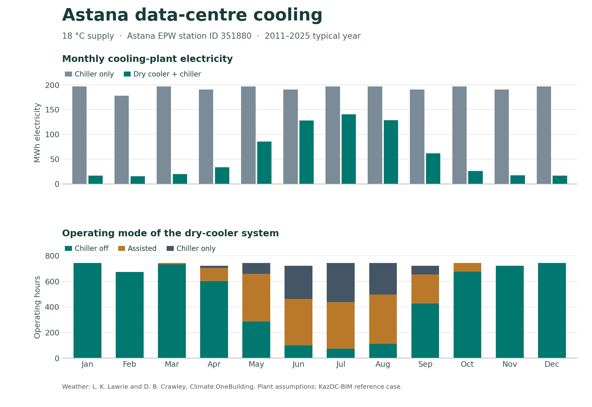

# KazDC Energy Tech

English · [Қазақша](README.kk.md) · [Русский](README.ru.md) · [简体中文](README.zh.md)

[Open the interactive platform](https://ktwyw.github.io/kazdc-energy-tech/) · [Research priorities for Kazakhstan](https://ktwyw.github.io/kazdc-energy-tech/research-priorities.html) · [One-page meeting brief (PDF)](reference/KazDC_Research_Brief_EN.pdf)

[INMET](https://inmet.nu.edu.kz/), the Institute of New Materials and Energy Technologies at Nazarbayev University, is the project affiliation. Contact Dr. Yanwei Wang at [yanwei.wang@nu.edu.kz](mailto:yanwei.wang@nu.edu.kz).

KazDC Energy Tech is an interactive KazDC-BIM modelling platform for studying energy-efficient data centres in Kazakhstan. It runs offline. The same plant can be run against published weather files for 21 cities. Technology studies connect the calculated energy flows to measurements that students or engineering teams can make.

Open [the platform](index.html) in a browser after extracting the project. The models run on the device and all weather data are included. The homepage shows annual cooling electricity and chiller-off hours, alongside worked examples for snow storage, heat recovery and UPS losses. The monthly weather comparison is beside the [station archives](references.html#weather-comparison). Regional cooling and heat recovery cover Kazakhstan’s 17 regional centres, Astana, Almaty, Shymkent and Ekibastuz. Each city has its own 8,760-hour typical year. The station notes identify the source period, weather station or reanalysis location, and original archive. [Regional weather data](data/regions/README.md)

All ten sections are available in English, Қазақша, Русский and 简体中文. Use the **Language** menu in the header to open the same section in another language. On the regional dashboard, switching languages retains the modelled city, comparison city and coolant supply temperature.

On the homepage, try 24 °C to see how July changes for the selected city. [Compare two cities month by month](index.html#city-comparison) at a shared supply temperature and download both series. **Copy this case** includes the model settings, version and public link. Measured worksheet entries stay in the browser tab.

| Study | What the reader can do | Boundary |
|---|---|---|
| [Research priorities for Kazakhstan](research-priorities.html) | Test two July supply settings in Ekibastuz and read the proposed first study with an operator | One-page [meeting brief](reference/KazDC_Research_Brief_EN.pdf) with suggested staff time, metering and validation |
| [Regional cooling](index.html#compare) | Compare cooling electricity and chiller-off hours for 21 cities at the selected coolant supply temperature. Export annual or monthly results. | Electricity for chiller, dry-cooler fan and loop pump at a fixed 1 MW IT load |
| [Astana reference plant](astana.html) and [methods](methods.html) | Explore 49 setpoints and audit an hourly dispatch decision | Detailed reference case for Astana |
| [Seasonal snow cooling](snow.html) | Size a store, try two discharge policies and replay a separate seven-day, 5 kW simulation | Astana storage scenario and a separately documented numerical benchmark |
| [Heat recovery](heat.html) | Match direct exchange or heat-pump-assisted delivery to an illustrative weather-dependent building load | Delivered heat, captured IT heat and compressor work recorded separately |
| [UPS losses](power.html) | Compare two operating efficiencies at the same IT output | Electrical input and output at the UPS terminals |
| [References](references.html) · [Қазақша](references-kk.html) · [Русский](references-ru.html) · [简体中文](references-zh.html) | Trace the weather, equations and experiment methods to their public sources | Includes station archives, project assumptions and reference outputs |
| [Water-loop experiment](bench.html) | Enter a prediction and timed readings, then export the signed energy residual | Steady liquid-water test section, with a labelled example and a blank measured-run worksheet |
| [Adiabatic-assisted dry cooling](technologies.html?study=pad) | Set a summer water budget, pad effectiveness and an outdoor trigger | Hourly wet-bulb limit, make-up water, pump and fan input, and extra complete chiller-off hours |
| [Direct-to-chip cold plates](technologies.html?study=cold) | Use the example or enter a heater and water-loop measurement | Liquid heat capture, plate-to-inlet thermal resistance and pump input attributable to the plate |
| [Indirect outdoor-air cooling](technologies.html?study=air) | Vary air temperatures, exchanger effectiveness, fan power and frost lockout | Closed-loop sensible exchanger with backup cooling, compared with the reference water loop |
| [Glycol and variable-speed pumps](technologies.html?study=glycol) | Compare discrete propylene-glycol mixtures, pipe geometry and wider loop temperature rise | Pipe-circuit electricity at 1 MW and outdoor exposure hours below first ice |
| [Overnight chilled-water storage](technologies.html?study=tank) | Charge a finite store from spare night-time dry cooling and discharge during the afternoon | Chronological thermal inventory, transfer electricity and maximum hourly cooling demand |
| [Solar PV and batteries](technologies.html?study=solar) | Size a horizontal array, battery, power limit and reserve | Hourly PV generation, site demand, grid purchases, curtailment and battery losses |

**Use in class.** Predict which city will give more chiller-off hours at 18 °C, then use each city's monthly table to explain the difference. Switch to heat recovery and raise the receiving temperature above the direct-exchange limit. Compare the additional compressor input with the additional heat delivered. In the bench worksheet, enter mass flow and temperature readings from a matched interval to test whether a predicted heat duty is reproducible.

**Rebuild and verify.** Run `python build.py` to regenerate the pages, reference CSVs, self-contained project download and deployable `dist/` directory. Run `python -m unittest discover -s tests -v` and `node --test`. All build, model and test dependencies are included in standard Python 3.10+ and Node.js 18+. The optional reference-figure script uses Matplotlib.

To update all four one-page briefs from the localised text and the current July calculations, run `python build.py --refresh-briefs`. The optional PDF step uses ReportLab, PyMuPDF and Noto Sans. The checked-in briefs are included in a normal build.

**Checks on the weather and models.** The calculation tests compare all 21 cities at all 49 supply temperatures. At 18 °C the Astana reference uses 690.85 MWh of cooling electricity and has 5,888 chiller-off hours. Almaty uses the international airport file and gives 808.84 MWh and 5,382 hours. That file is cooler than local airport observations in several summer months. The weather notes include the station-month comparisons and the solar timing checks. Snow inventory, spray-pump runtime, storage dispatch on the UTC+5 civil clock, heat-pump feasibility and battery energy balances can be checked separately. [Station comparisons](data/regions/README.md) · [Hourly technology inputs](data/technology-weather/README.md)

Regional cooling and heat recovery use monthly dry-bulb frequency counts, which preserve sums of independent hourly decisions at a given temperature. Snow storage uses chronological Astana weather. The technology workbench includes all 21 chronological dry-bulb, derived wet-bulb and horizontal solar series. It runs entirely offline and each study exports its results with the active settings. Measurements stay in the browser unless the reader exports them. Each study states its energy boundary and reference configuration. [Regional data notes](data/regions/README.md) · [Humidity, pressure, solar and wet-bulb calculation](data/technology-weather/README.md)

## Astana reference case

**KazDC-BIM reference case | Astana, Kazakhstan.** A fixed 1 MW IT load releases 8,760 MWh of heat during one typical year. At an 18 °C coolant supply temperature, the model transfers **6,987 MWh of heat (79.8%)** through a dry cooler and keeps the chiller off for **5,888 hours (67.2%)**. Including fans and pumping, annual cooling-plant electricity falls from **2,321.4 to 690.8 MWh**, a **70.2%** reduction.

## Run the study

**Browser:** extract the project and open [the Astana dashboard](astana.html). Move the supply-temperature slider from 8 to 32 °C in 0.5 °C steps. Both monthly charts, the data table and its CSV download follow the selected temperature. The page works offline. The 49 cases are calculated in Python at build time and embedded in the page.

Open [Cooling model and methods](methods.html) to derive the two outdoor-temperature thresholds, trace any of five actual weather records through the heat and electricity balances, and reconcile the monthly and annual totals. Worked examples use the 18 °C reference supply. The dashboard method summary updates with the selected supply temperature.

The snow calculator uses the supply temperature selected on the dashboard. Try using stored snow whenever the dry cooler needs help, then reserve the same amount for the hottest hours. Compare when the stock runs out, how many extra hours the chiller can stay off, and how much electricity the plant saves. [Seasonal snow cooling](snow.html)

The storage comparison asks how much ice an insulated container, a panel store and a covered pile could retain by July. A separate seven-day SnowCool simulation shows how contact between water and ice affects the cooling power available at a steady 5 kW load.

### The snow scenario

The central plant’s dry-cooler dispatch comes from the same Python calculation as the original dashboard. Between 1 June and 31 August, an additional meltwater loop can displace up to the remaining chiller duty each hour. The stock is specified independently of weather. Inputs include compacted volume, ice-equivalent density, usable fraction at the start of summer, exchanger duty achievable at the chosen supply temperature, snow-pump electricity and optional additional electric handling per tonne of initial ice. The temperature-triggered policy visits eligible hours chronologically. Useful demand, equipment and inventory must all be available for discharge.

At the example settings of 18 °C supply, 4,000 m³, 550 kg of ice equivalent per m³ and 70% usable capacity, the model starts June with 142.66 MWh of useful thermal energy. The assumed 500 kW exchanger and 5 kW pump give 34.24 MWh of additional annual plant electricity savings before handling. With immediate dispatch this adds 126 complete chiller-off hours and exhausts the usable stock on 18 June. With a 25 °C outdoor trigger the stock lasts until 13 July. In both cases the typical-year peak chiller duty is 1 MW. The same fixed COP and pump energy per unit heat give equal electricity savings when both policies use the entire stock. These are scenario results. A site-specific estimate requires measurements of recoverable snow, thermal losses, pump power and achieved exchanger duty.

The facility model treats the input usable fraction as a single allowance and holds effective exchanger duty constant. The three-store comparison uses assumed mean heat gains from 1 April to 1 July. The separate five-kilowatt replay uses the earlier study’s coupled, state-dependent contact and exchanger calculation. The browser can export a 12-month CSV and an annual total with the active scenario inputs. The input sources and replay extraction method are in [data/README.md](data/README.md).

**Python:** from the project directory, run the commands below with Python 3.10 or later. The model, data tools, dashboard builder and tests use the standard library.

```bash
python cooling.py
python cooling.py --supply 24 --output results_24C
python -m unittest discover -s tests -v
```

The second command writes hourly, monthly and annual CSVs. Supply temperature can be any finite value at the command line. Use values within the operating envelope of the system being studied. To investigate different equipment, copy [case.json](case.json), edit the copy and pass it with `--case`. To rebuild the dashboard and the bundled default outputs after editing the reference inputs, run `python build.py`.

## What changes with supply temperature?

| Supply | Chiller-only electricity | Dry cooler + chiller electricity | Cooling electricity saved | Chiller off | IT heat removed by dry cooler |
|---:|---:|---:|---:|---:|---:|
| 12 °C | 2,321.4 MWh | 991.6 MWh | 57.3% | 4,802 h | 65.6% |
| 18 °C | 2,321.4 MWh | 690.8 MWh | 70.2% | 5,888 h | 79.8% |
| 24 °C | 2,321.4 MWh | 429.0 MWh | 81.5% | 7,226 h | 91.6% |

At 18 °C the chiller stays off throughout January, February, November and December. In July it stays off for 74 of 744 hours and operates with dry-cooler assistance for another 365 hours. The full year contains 5,888 dry-only hours, 1,893 assisted hours and 979 chiller-only hours. Partial cooling explains why the dry cooler removes a larger share of annual heat than its share of full-load, chiller-off hours.



## Plant boundary and assumptions

The IT equipment releases a constant sensible heat load into a closed coolant loop. The return coolant reaches the dry cooler first and the chiller removes any remaining heat. Both plant arrangements meet the same load and supply setpoint. The outdoor heat exchanger uses dry-bulb temperature, with no evaporative stage.

| Assumption | Reference value | Meaning |
|---|---:|---|
| IT heat load, $Q$ | 1,000 kW thermal | Held constant every hour in both arrangements |
| Supply temperature, $T_s$ | 18 °C | User-controlled coolant temperature delivered by the plant |
| Return-to-supply rise, $\Delta T$ | 6 K | Fixed flow and heat load give $T_r=T_s+\Delta T$ |
| Rated dry-cooler approach, $A$ | 5 K | Leaving coolant minus entering air at full duty and design airflow |
| Chiller coefficient of performance, COP | 4.0 | Delivered cooling divided by chiller-package electricity, including condenser auxiliaries |
| Dry-cooler fan at full speed, $F$ | 25 kW electric | Average fan draw scales with its fraction of the hour on |
| Common loop pump, $P_p$ | 15 kW electric | Included in both systems throughout the year |

The same full-fan heat-transfer coefficient applies at every supply setting. The case compares controls and weather availability for one plant. Changing the IT load *in the equipment file* sizes the dry cooler to that new reference duty. To represent a specific installation, obtain its design duty, fan and pump loads, coolant flow, approach and chiller performance map.

### Hourly heat balance

At the rated point, full dry cooling is just possible when $T_a=T_s-A$, where $T_a$ is the outdoor dry bulb. The effective full-fan coefficient is $G=Q/(\Delta T+A)$, or 90.91 kW/K in this case. With fixed coolant and air flow rates, the full-fan capacity and useful dry cooling before dispatch are

$$
Q_{\mathrm{cap}}=G\max(0,T_r-T_a),\qquad
Q_d=\min(Q,Q_{\mathrm{cap}}).
$$

For positive capacity, the required fan duty fraction is $d=Q_d/Q_{\mathrm{cap}}$. It equals one during partial cooling. During colder hours a single-speed fan cycles and the loop buffers the load over the hour. Fan-off heat rejection is assumed zero. The candidate electricity use is

$$
P_{\mathrm{hybrid}}=P_p+dF+\frac{Q-Q_d}{\mathrm{COP}},\qquad
P_{\mathrm{base}}=P_p+\frac{Q}{\mathrm{COP}}.
$$

Dispatch chooses the lower of these two electricity demands. At equal power it bypasses the dry cooler. Zero capacity also means bypass. Across all dispatched modes the balance is $Q_d+Q_{\mathrm{chiller}}=Q$. Multiplying each hourly power by one hour and summing gives the monthly and annual energies.

Two hand calculations illustrate the control at 18 °C supply. With 2 °C outdoor air, full-fan capacity is 2,000 kW. A half-hour of fan operation meets the hourly heat load and the plant averages 27.5 kW electric. With 18.5 °C outdoor air, full-fan capacity falls to 500 kW. The fan runs continuously, the chiller supplies the other 500 kW of heat removal, and the plant draws 165 kW electric.

| At 18 °C supply | Dispatch | Electricity calculation |
|---|---|---|
| Outdoor temperature ≤ 13 °C | Chiller off, dry cooler carries the complete load | Common pump + cycling fan |
| 13 °C < outdoor temperature < 22.9 °C | Dry cooler assists the chiller | Common pump + full fan + chiller package on remaining load |
| Outdoor temperature ≥ 22.9 °C | Dry cooler bypassed | Common pump + chiller package |

With 18 °C supply, the coolant returns at 24 °C. As the outdoor air warms to 24 °C, full-fan capacity falls to zero. The controller begins bypassing the dry cooler at an outdoor temperature of 22.9 °C, where removing 100 kW of heat with the dry cooler saves 25 kW of chiller input at COP 4, exactly the power the fan requires. The 18 °C reference therefore has a wider temperature band for zero useful electrical savings than a temperature-only on/off rule would suggest.

### Interpreting the result

Cooling-plant electricity includes the chiller package, dry-cooler fan and common pump. The 18 °C hybrid total comprises 443.28 MWh for the chiller package, 116.16 MWh for the dry-cooler fan and 131.40 MWh for the common pump. IT electricity, indoor air handling, UPS losses and other facility loads lie outside the electricity comparison. The 70.2% applies to this plant boundary.

The baseline stays flat across supply temperatures because COP is held constant. Real chiller COP changes with lift and part load. The fixed approach and hourly fan cycling also idealize fluid properties, exchanger fouling, minimum run times, freeze protection and controls. The weather file is a representative year for estimating energy. Site design and resilience studies require equipment envelopes, freeze-protection strategy, peak conditions and multi-year weather. The displayed coolant settings are study inputs.

The equipment assumptions matter even at the same 18 °C setpoint. A dry cooler sized for a 3 K rated approach gives **6,367 chiller-off hours** and **625.2 MWh** of hybrid electricity. At a 7 K approach the estimates become **5,461 hours** and **755.4 MWh**. Each comparison changes only the approach in the plant input file. A measured or manufacturer-rated approach at the intended load would therefore be a valuable input for a site-specific case.

## Weather, outputs and reproducibility

The [bundled hourly CSV](data/astana_hourly.csv) contains all 8,760 hourly dry-bulb values used in the model. The [data notes](data/README.md) give the original EnergyPlus weather file, source years, station metadata, attribution, checksums and regeneration commands. The weather-file values and the simulated equipment results are distributed in separate files.

| File | Use |
|---|---|
| [reference/hourly.csv](reference/hourly.csv) | Trace each 18 °C dispatch, heat duty, fan fraction and component electricity |
| [reference/monthly.csv](reference/monthly.csv) | Twelve months of energy and operating hours at 18 °C |
| [reference/annual.csv](reference/annual.csv) | Annual totals at 18 °C, stored to six decimal places |
| [reference/supply_sweep.csv](reference/supply_sweep.csv) | Annual metrics for all 49 dashboard setpoints |
| [cooling.py](cooling.py) · [case.json](case.json) | Dispatch calculation and editable equipment assumptions |
| [methods.html](methods.html) · [methods.py](methods.py) | Detailed methods, source-hour examples and equipment sensitivity calculated from the reference model |
| [snow.html](snow.html) · [snow_inputs.py](snow_inputs.py) · [web/snow-model.js](web/snow-model.js) | Summer snow dispatch and inverse sizing, plant electricity, ice retention in three example stores, and the seven-day replay |
| [web/](web/) · [build.py](build.py) | Page templates, offline charts and one-command rebuild |
| [tests/](tests/) | Hand-calculated cases, data integrity, heat and power accounting, and independent temperature-threshold counts |

In the outputs, `_kw_th` and `_mwh_th` denote heat duty and heat energy. The `_e` suffix denotes electricity. In the hourly file `dry_only` means the chiller is off, `assisted` means both units operate, and `chiller_only` means the dry cooler is bypassed. Summed hourly kW values are numerically equal to kWh for these one-hour records. Percentages in the annual row use annual totals.

The pages run from local files or a static web server. For this GitHub Pages project, publish the repository root from the `main` branch. The root already contains `index.html` and `source.zip`. Include the regenerated HTML, reference files and `source.zip` when committing a rebuild. If the GitHub owner or repository name changes, update `PUBLIC_SITE` in `platform_build.py`, the published URLs at the top of these guides, and run `python build.py --refresh-briefs` to update shared-case and PDF links. Run `python build.py --downloads exports` to create the named portable HTML files. Keep them in the same directory for navigation. The optional command `python plot_reference.py` regenerates the English guide figure using Matplotlib. Use `python plot_reference.py --language all` to regenerate all four editions. The Chinese figure also needs a font with Chinese glyphs, such as Noto Sans CJK. All pages rebuild offline using the supplied CSVs. With Node.js installed, run `node --test tests/snow.test.cjs` to check the browser’s snow dispatch and energy balances.

### Sources

- Linda K. Lawrie and Drury B. Crawley (2026), *Development of Global Typical Meteorological Years (TMYx)*. [Climate.OneBuilding source notes](https://climate.onebuilding.org/sources/default.html) · [Kazakhstan files](https://climate.onebuilding.org/WMO_Region_2_Asia/KAZ_Kazakhstan/index.html)
- The EnergyPlus Engineering Reference describes higher-detail single-speed and two-speed dry fluid cooler models. This study uses the full-fan coefficient calibrated at one rated point and the dispatch equations above. [EnergyPlus fluid-cooler reference](https://bigladdersoftware.com/epx/docs/24-2/engineering-reference/cooling-towers-and-evaporative-fluid-coolers.html#one-and-two-speed-fluid-coolers)
- The EnergyPlus weather data dictionary defines the input fields and missing-data conventions. [EPW data dictionary](https://bigladdersoftware.com/epx/docs/24-2/auxiliary-programs/energyplus-weather-file-epw-data-dictionary.html)
