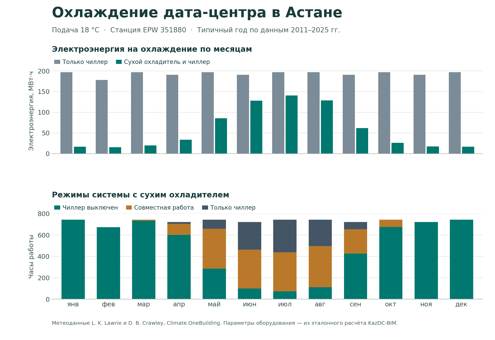

# KazDC Энерготехнологии

[English](README.md) · [Қазақша](README.kk.md) · Русский · [简体中文](README.zh.md)

[Открыть интерактивную платформу](https://ktwyw.github.io/kazdc-energy-tech/regional-ru.html) · [Приоритеты исследований для Казахстана](https://ktwyw.github.io/kazdc-energy-tech/research-priorities-ru.html) · [Одностраничная справка для встречи (PDF)](reference/KazDC_Research_Brief_RU.pdf)

**Организация проекта** — [INMET](https://inmet.nu.edu.kz/ru), Институт новых материалов и энергетических технологий, Назарбаев Университет. **Контактное лицо** — Янвей Ванг, PhD · [yanwei.wang@nu.edu.kz](mailto:yanwei.wang@nu.edu.kz).

KazDC Энерготехнологии — интерактивная платформа KazDC-BIM для исследования энергоэффективных дата-центров в Казахстане. Она работает без подключения к интернету. Одну и ту же установку можно рассчитать по опубликованным метеоданным 21 города. В технологических исследованиях расчётные потоки энергии сопоставляются с величинами, которые могут измерить студенты и инженеры.

Распакуйте проект и откройте [главную страницу](regional-ru.html) в браузере. Вычисления выполняются на устройстве пользователя, все метеоданные включены в проект. На главной странице показаны годовое потребление электроэнергии на охлаждение и число часов с отключённым чиллером. Приведены примеры использования запасённого снега, утилизации тепла и снижения потерь в источнике бесперебойного питания (ИБП). Сравнение среднемесячных температур размещено рядом с [архивами метеостанций](references-ru.html#weather-comparison). Расчёты охлаждения и утилизации тепла охватывают центры 17 областей Казахстана, а также Астану, Алматы, Шымкент и Экибастуз. Для каждого города используется свой типичный год из 8 760 часов. В описании указаны период исходных данных, станция или точка реанализа и ссылка на исходный архив. [Метеоданные по городам](data/regions/README.ru.md)

Все десять разделов доступны на английском, казахском, русском и китайском (упрощённое письмо) языках. Меню **Язык** вверху страницы открывает тот же раздел на выбранном языке. В региональном расчёте сохраняются город установки, город для сравнения погоды и температура подачи теплоносителя.

На главной странице выберите 24 °C и посмотрите, как изменится июльский результат для вашего города. В разделе [помесячного сравнения двух городов](regional-ru.html#city-comparison) можно задать общую температуру подачи и скачать оба ряда данных. Команда «Скопировать расчёт» копирует настройки, версию модели и общедоступную ссылку. Введённые измерения остаются в текущей вкладке браузера.

| Исследование | Что можно сделать | Границы расчёта |
|---|---|---|
| [Приоритеты исследований для Казахстана](research-priorities-ru.html) | Сравнить два значения температуры подачи в июле в Экибастузе и ознакомиться с планом первого исследования с оператором | [Одностраничная записка к встрече](reference/KazDC_Research_Brief_RU.pdf) с оценкой трудозатрат, затрат на измерения и планом проверки |
| [Охлаждение по городам](regional-ru.html#compare) | Сравнить электропотребление на охлаждение и часы без чиллера в 21 городе при выбранной температуре подачи, выгрузить годовые или месячные результаты. | Электроэнергия чиллера, вентилятора сухого охладителя и циркуляционного насоса при постоянной ИТ-нагрузке 1 МВт |
| [Эталонная установка в Астане](astana-ru.html) и [методика](methods-ru.html) | Проверить 49 уставок температуры и проследить выбор режима в конкретном часу | Подробный расчёт для Астаны |
| [Сезонное охлаждение снегом](snow-ru.html) | Подобрать объём хранилища, проверить две стратегии расходования запаса и воспроизвести отдельный семисуточный расчёт для нагрузки 5 кВт | Сценарий хранения в Астане и отдельно документированный численный эталон |
| [Утилизация тепла](heat-ru.html) | Сопоставить прямую передачу тепла и подачу тепла с тепловым насосом с зависящей от погоды нагрузкой условного здания | Отдельно учитываются тепло, доставленное в здание, отведённое тепло ИТ-оборудования и работа компрессора |
| [Потери ИБП](power-ru.html) | Сравнить два значения КПД при одинаковой выходной мощности для ИТ-оборудования | Входная и выходная электрическая мощность на клеммах ИБП |
| [Источники](references-ru.html) | Найти открытые источники метеоданных, уравнений и методов эксперимента | Архивы станций, принятые допущения и эталонные результаты |
| [Эксперимент с водяным контуром](bench-ru.html) | Задать прогноз, ввести измерения за выбранный интервал и выгрузить невязку энергетического баланса с её знаком | Участок контура с жидкой водой в установившемся режиме, помеченный пример и пустой бланк для собственных измерений |
| [Сухой охладитель с адиабатическим предохлаждением](technologies-ru.html?study=pad) | Задать летний запас воды, эффективность увлажняющей насадки и порог включения по наружной температуре | Почасовой предел по температуре мокрого термометра, подпиточная вода, мощность насоса и вентилятора, дополнительные полные часы с отключённым чиллером |
| [Холодные пластины для прямого охлаждения чипов](technologies-ru.html?study=cold) | Использовать пример или ввести измерения нагревателя и водяного контура | Тепло, отведённое жидкостью, термическое сопротивление от пластины до воды на входе и мощность насоса, необходимая для преодоления сопротивления пластины |
| [Косвенное охлаждение наружным воздухом](technologies-ru.html?study=air) | Менять температуры воздуха, эффективность теплообменника, мощность вентилятора и порог отключения при риске обмерзания | Теплообменник явного тепла в замкнутом контуре с резервным охлаждением в сравнении с эталонным водяным контуром |
| [Гликолевые контуры и насосы с регулированием скорости](technologies-ru.html?study=glycol) | Сравнить заданные концентрации пропиленгликоля, геометрию трубопровода и увеличенный перепад температур в контуре | Электроэнергия на прокачку при тепловой нагрузке 1 МВт и часы, когда температура наружного воздуха ниже температуры начала кристаллизации |
| [Ночное аккумулирование холода в воде](technologies-ru.html?study=tank) | Запасать холод за счёт свободной мощности сухого охладителя ночью и отдавать его во второй половине дня | Запас холода по часам, электроэнергия на его передачу и максимальная часовая потребность в охлаждении |
| [Солнечные панели и аккумуляторы](technologies-ru.html?study=solar) | Задать размер горизонтальной фотоэлектрической установки, ёмкость и мощность батареи, резерв заряда | Почасовая выработка, потребность объекта, закупка из сети, ограничение выработки и потери батареи |

**Для занятия.** Предскажите, в каком из двух городов чиллер сможет дольше оставаться выключенным при подаче 18 °C. Объясните различие по месячным таблицам. В модели утилизации тепла поднимите температуру у потребителя выше предела прямого теплообмена. Сравните дополнительную работу компрессора с дополнительным количеством доставленного тепла. В бланк эксперимента введите массовый расход и температуры за один и тот же интервал и проверьте, воспроизводится ли предсказанная тепловая мощность.

**Сборка и проверка.** Команда `python build.py` заново создаёт страницы, эталонные CSV, автономный архив проекта и каталог `dist/` для размещения на сервере. Для проверки выполните `python -m unittest discover -s tests -v` и `node --test`. Для сборки, моделирования и тестов достаточно стандартных возможностей Python 3.10+ и Node.js 18+. Необязательный скрипт построения эталонного рисунка использует Matplotlib.

Чтобы обновить все четыре одностраничные записки по текущим июльским расчётам и переводам, выполните `python build.py --refresh-briefs`. Для обновления PDF нужны ReportLab, PyMuPDF и Noto Sans. При обычной сборке используются записки, включённые в проект.

**Проверки метеоданных и моделей.** Тесты охватывают 21 город при всех 49 температурах подачи. При 18 °C эталонная установка в Астане потребляет 690,85 МВт·ч в год на охлаждение, чиллер выключен 5 888 часов. Для Алматы используется файл международного аэропорта, результаты — 808,84 МВт·ч и 5 382 часа. В этом файле температуры в некоторые летние месяцы ниже, чем по наблюдениям в аэропорту. В примечаниях приведены сопоставления по станциям и месяцам и проверка времени регистрации солнечной радиации. По отдельности можно проверить запас снега, время работы насоса орошения, график аккумулятора холода по гражданскому времени UTC+5, допустимость режима теплового насоса и энергетический баланс батареи. [Сравнение станций](data/regions/README.ru.md) · [Почасовые входные данные](data/technology-weather/README.ru.md)

Для регионального охлаждения и утилизации тепла используются помесячные частоты температур сухого термометра. Суммы независимых почасовых решений при данной температуре при этом сохраняются. Расход снега рассчитывается по хронологическому ряду для Астаны. В технологических моделях доступны последовательные почасовые ряды всех 21 городов для температуры сухого термометра, расчётной температуры мокрого термометра и солнечного облучения горизонтальной поверхности. Все модели работают автономно. Результаты каждого исследования можно выгрузить вместе с использованными настройками. Измерения остаются в браузере до экспорта. Для каждого исследования указаны границы энергетического баланса и эталонная конфигурация. [Региональные данные](data/regions/README.ru.md) · [Влажность, давление, солнечное излучение и расчёт температуры мокрого термометра](data/technology-weather/README.ru.md)

## Эталонный расчёт для Астаны

**Эталонный расчёт KazDC-BIM, Астана, Казахстан.** При постоянной мощности 1 МВт ИТ-оборудование выделяет за типичный год 8 760 МВт·ч тепла. При температуре подачи 18 °C сухой охладитель отводит **6 987 МВт·ч тепла (79,8 %)**, а чиллер выключен **5 888 часов (67,2 %)**. С учётом вентилятора и насоса годовое потребление электроэнергии холодильной установкой снижается **с 2 321,4 до 690,8 МВт·ч**, то есть на **70,2 %**.

## Как запустить расчёт

**В браузере.** Распакуйте проект и откройте [расчётную панель для Астаны](astana-ru.html). Ползунком задайте температуру подачи от 8 до 32 °C с шагом 0,5 °C. Оба помесячных графика, таблица и загружаемый CSV соответствуют выбранной температуре. Страница работает без интернета. Все 49 вариантов рассчитываются в Python при сборке и встраиваются в страницу.

Откройте [описание модели и методики](methods-ru.html), чтобы вывести два порога наружной температуры, проследить тепловой и электрический балансы для любой из пяти реальных метеозаписей и сверить месячные и годовые суммы. В разобранных примерах температура подачи равна 18 °C. Краткое описание на панели обновляется при изменении уставки.

Калькулятор снега использует температуру подачи, выбранную на панели. Сначала расходуйте снег, как только мощности сухого охладителя не хватает, затем при том же запасе разрешите расход лишь в самые жаркие часы. Сравните даты исчерпания запаса, дополнительные полные часы отключения чиллера и сэкономленную электроэнергию. [Сезонное охлаждение снегом](snow-ru.html)

В расчёте сравнивается запас льда, который может сохраниться к июлю в утеплённом контейнере, в хранилище из теплоизоляционных панелей и в бурте под укрытием. Отдельная семисуточная модель SnowCool показывает, как контакт между водой и льдом влияет на доступную холодопроизводительность при постоянной нагрузке 5 кВт.

### Сценарий накопления снега

Сухой охладитель центральной установки работает по тому же расчёту на Python, что и в исходной панели. С 1 июня по 31 августа дополнительный контур талой воды каждый час может покрывать оставшуюся нагрузку чиллера в пределах доступной мощности. Начальный запас снега задаётся независимо от погоды. Входные параметры включают уплотнённый объём, массу льда в пересчёте на единицу объёма, полезную долю в начале лета, достижимую мощность теплообменника при выбранной температуре подачи, электрическую мощность насоса и, при необходимости, дополнительные затраты электроэнергии на перемещение одной тонны исходного льда. Алгоритм с порогом температуры рассматривает подходящие часы в хронологическом порядке. Для отдачи холода необходимы потребность в охлаждении, доступная мощность оборудования и запас льда.

В примере заданы подача 18 °C, объём 4 000 м³, 550 кг ледового эквивалента на м³ и полезная доля 70 %. Тогда в начале июня запас полезного холода равен 142,66 МВт·ч. При мощности теплообменника 500 кВт и электрической мощности насоса 5 кВт дополнительная годовая экономия установки составляет 34,24 МВт·ч до учёта затрат на перемещение снега. При немедленном использовании чиллер дополнительно выключен 126 полных часов, а запас заканчивается 18 июня. При пороге наружной температуры 25 °C снега хватает до 13 июля. В обоих случаях пиковая тепловая нагрузка на чиллер в типичном году составляет 1 МВт. Если обе стратегии исчерпывают весь запас, они обеспечивают равную экономию благодаря одинаковым фиксированным COP и расходу электроэнергии насоса на единицу полезного холода. Это результаты расчётных сценариев. Для оценки конкретной площадки нужны измерения доступного снега, теплопритоков, мощности насоса и достигнутой мощности теплообменника.

В расчёте объекта введённая полезная доля учитывается одним коэффициентом, а эффективная мощность теплообменника постоянна. Для каждого из трёх вариантов хранения задаётся средний приток тепла с 1 апреля по 1 июля. В отдельном воспроизведении модели мощностью 5 кВт контакт и теплообмен рассчитываются совместно с учётом текущего состояния, как в исходном исследовании. Из браузера можно выгрузить CSV с данными за 12 месяцев, итогом за год и входными параметрами текущего сценария. Источники и способ извлечения семисуточного ряда приведены в [описании данных](data/README.ru.md).

**В Python.** Выполните команды из каталога проекта, используя Python версии 3.10 или выше. Модель, средства подготовки данных, сборщик страниц и тесты используют стандартную библиотеку.

```bash
python cooling.py
python cooling.py --supply 24 --output results_24C
python -m unittest discover -s tests -v
```

Вторая команда записывает почасовой, помесячный и годовой CSV. В командной строке можно передать любую конечную температуру подачи. Для анализа выбирайте значения в рабочем диапазоне исследуемой установки. Чтобы задать другое оборудование, скопируйте [case.json](case.json), измените копию и передайте её через `--case`. После изменения эталонных входных данных пересоберите панель и стандартные выходные файлы командой `python build.py`.

## Что меняется с температурой подачи?

| Подача | Электроэнергия при работе одного чиллера | Электроэнергия сухого охладителя и чиллера | Экономия электроэнергии на охлаждение | Часы с отключённым чиллером | Доля тепла ИТ-нагрузки, отведённая сухому охладителюй |
|---:|---:|---:|---:|---:|---:|
| 12 °C | 2 321,4 МВт·ч | 991,6 МВт·ч | 57,3 % | 4 802 ч | 65,6 % |
| 18 °C | 2 321,4 МВт·ч | 690,8 МВт·ч | 70,2 % | 5 888 ч | 79,8 % |
| 24 °C | 2 321,4 МВт·ч | 429,0 МВт·ч | 81,5 % | 7 226 ч | 91,6 % |

При подаче 18 °C чиллер остаётся выключенным весь январь, февраль, ноябрь и декабрь. Из 744 часов июля он выключен 74 часа, ещё 365 часов работает совместно с сухому охладителюй. За год сухой охладитель работает самостоятельно 5 888 часов, совместно с чиллером — 1 893 часа. Работа одного чиллера занимает 979 часов. Сухой охладитель отводит тепло и в совместном режиме. Поэтому доля отведённого им годового тепла выше доли часов, когда он полностью покрывает нагрузку.



[Открыть интерактивные графики](astana-ru.html#charts)

## Границы установки и допущения

ИТ-оборудование передаёт постоянную нагрузку явного тепла в замкнутый жидкостный контур. Возвращающийся теплоноситель сначала поступает в сухой охладитель, затем оставшееся тепло отводит чиллер. Обе конфигурации обеспечивают одинаковую нагрузку и уставку подачи. Наружный теплообменник рассчитывается по температуре сухого термометра, без испарительной ступени.

| Допущение | Эталонное значение | Смысл |
|---|---:|---|
| Тепловая нагрузка ИТ, $Q$ | 1 000 кВт тепловой мощности | Постоянна каждый час в обеих конфигурациях |
| Температура подачи, $T_s$ | 18 °C | Устанавливаемая пользователем температура теплоносителя на выходе установки |
| Перепад между обратной и подающей линиями, $\Delta T$ | 6 K | При постоянных расходе и нагрузке $T_r=T_s+\Delta T$ |
| Номинальная разность температур на холодном конце сухого охладителя, $A$ | 5 K | Разность между температурой выходящего теплоносителя и входящего воздуха при полной нагрузке и расчётном расходе воздуха |
| Холодильный коэффициент чиллера, COP | 4,0 | Отводимое тепло, делённое на электроэнергию чиллерного агрегата, включая вспомогательные системы конденсатора |
| Вентилятор сухого охладителя на полной скорости, $F$ | 25 кВт электрической мощности | Средняя потребляемая мощность пропорциональна доле часа, когда вентилятор включён |
| Общий циркуляционный насос, $P_p$ | 15 кВт электрической мощности | Учитывается весь год в обеих системах |

Эффективный коэффициент теплопередачи при полной скорости вентилятора одинаков при всех уставках подачи. Модель сравнивает управление и возможность использовать наружный воздух для одной установки. При изменении ИТ-нагрузки *в файле параметров оборудования* мощность сухого охладителя пересчитывается под новую эталонную тепловую мощность. Для конкретного объекта потребуются номинальная мощность оборудования, нагрузки вентилятора и насоса, расход теплоносителя, расчётная разность температур и карта рабочих характеристик чиллера.

### Почасовой тепловой баланс

В расчётной точке сухой охладитель едва может обеспечить полное охлаждение при $T_a=T_s-A$, где $T_a$ — наружная температура сухого термометра. Эффективный коэффициент при полной скорости вентилятора равен $G=Q/(\Delta T+A)$, для этого случая 90,91 кВт/К. При фиксированных расходах воздуха и теплоносителя доступная мощность при полной скорости и полезная мощность сухого охладителя до выбора режима равны

$$
Q_{\mathrm{cap}}=G\max(0,T_r-T_a),\qquad
Q_d=\min(Q,Q_{\mathrm{cap}}).
$$

При положительной доступной мощности требуемая доля времени работы вентилятора $d=Q_d/Q_{\mathrm{cap}}$. При частичном покрытии нагрузки она равна единице. В холодные часы односкоростной вентилятор включается периодически, а тепловая инерция контура сглаживает нагрузку в пределах часа. При выключенном вентиляторе теплоотвод принят равным нулю. Электрическая мощность двух вариантов равна

$$
P_{\mathrm{hybrid}}=P_p+dF+\frac{Q-Q_d}{\mathrm{COP}},\qquad
P_{\mathrm{base}}=P_p+\frac{Q}{\mathrm{COP}}.
$$

Контроллер выбирает вариант с меньшей электрической мощностью. При равной мощности или нулевой располагаемой холодопроизводительности контроллер направляет теплоноситель в обход сухого охладителя. Во всех выбранных режимах выполняется баланс $Q_d+Q_{\mathrm{chiller}}=Q$. Энергии за месяц и за год получаются умножением каждой часовой мощности на один час и суммированием.

Два ручных расчёта показывают работу управления при подаче 18 °C. Когда на улице 2 °C, мощность при полной скорости вентилятора достигает 2 000 кВт. За полчаса работы вентилятора отводится необходимое за час тепло, а средняя электрическая мощность установки равна 27,5 кВт. При наружной температуре 18,5 °C мощность сухого охладителя снижается до 500 кВт. Вентилятор работает непрерывно, ещё 500 кВт тепла отводит чиллер. Электрическая мощность всей установки составляет 165 кВт.

| При подаче 18 °C | Работа оборудования | Состав потребляемой электрической мощности |
|---|---|---|
| Наружная температура ≤ 13 °C | Чиллер выключен, всю нагрузку несёт сухой охладитель | Общий насос и периодически работающий вентилятор |
| 13 °C < наружная температура < 22,9 °C | Сухой охладитель помогает чиллеру | Общий насос, постоянно работающий вентилятор и чиллер на остаточную нагрузку |
| Наружная температура ≥ 22,9 °C | Теплоноситель идёт в обход сухого охладителя | Общий насос и чиллер |

При обратной температуре теплоносителя 24 °C располагаемая мощность сухого охладителя обращается в нуль, когда наружный воздух прогревается до тех же 24 °C. Контроллер переходит на байпас уже при 22,9 °C. Замещение 100 кВт холодопроизводительности при COP 4 экономит лишь 25 кВт мощности чиллера — столько же потребляет вентилятор. Поэтому в примере с подачей 18 °C диапазон температур, в котором работа сухого охладителя не даёт чистой экономии электроэнергии, шире, чем при простом управлении по температуре.

### Как интерпретировать результат

К электроэнергии установки относятся чиллерный агрегат, вентилятор сухого охладителя и общий насос. В комбинированной схеме при 18 °C их годовые расходы составляют соответственно 443,28, 116,16 и 131,40 МВт·ч. Электроэнергия ИТ-оборудования, внутренних установок обработки воздуха, потери ИБП и прочие нагрузки объекта находятся за пределами сравнения. Экономия 70,2 % относится к указанным границам холодильной установки.

Базовое электропотребление одинаково при всех температурах подачи, поскольку COP фиксирован. Реальный COP зависит от температурного напора между испарением и конденсацией и от частичной нагрузки. Фиксированная расчётная разность температур и почасовое циклирование вентилятора также упрощают влияние свойств теплоносителя, загрязнения теплообменника, минимального времени работы, защиты от замерзания и автоматики. Типичный метеорологический год пригоден для оценки потребления энергии. Проектирование и оценка устойчивости конкретного объекта требуют рабочих диапазонов оборудования, стратегии защиты от замерзания, экстремальных условий и многолетних метеоданных. Уставки температуры на экране служат входными данными исследования.

Параметры оборудования существенны даже при неизменной подаче 18 °C. При расчётной разности температур 3 К чиллер выключен **6 367 часов**, а комбинированная установка потребляет **625,2 МВт·ч**. При 7 К оценки составляют **5 461 час** и **755,4 МВт·ч**. В каждом варианте в файле параметров меняется только эта разность температур. Для моделирования объекта полезно получить её измеренное или паспортное значение при заданной нагрузке.

## Метеоданные, результаты и воспроизводимость

[Почасовой CSV проекта](data/astana_hourly.csv) содержит все 8 760 значений температуры сухого термометра, использованных в расчёте. В [описании данных](data/README.ru.md) указаны исходный метеофайл EnergyPlus, годы, информация о станции, авторство, контрольные суммы и команды восстановления. Входные метеоданные и результаты моделирования оборудования распространяются отдельными файлами.

| Файл | Назначение |
|---|---|
| [reference/hourly.csv](reference/hourly.csv) | Проследить по часам при 18 °C выбор режима, тепловую мощность, долю времени работы вентилятора и потребление каждого компонента |
| [reference/monthly.csv](reference/monthly.csv) | Энергия и часы работы за 12 месяцев при 18 °C |
| [reference/annual.csv](reference/annual.csv) | Годовые итоги при 18 °C с шестью знаками после запятой |
| [reference/supply_sweep.csv](reference/supply_sweep.csv) | Годовые показатели для всех 49 уставок панели |
| [cooling.py](cooling.py) · [case.json](case.json) | Выбор режима и редактируемые параметры оборудования |
| [Методика](methods-ru.html) · [methods.py](methods.py) | Подробное описание, примеры на реальных почасовых данных и чувствительность эталонной модели к параметрам оборудования |
| [Расчёт снега](snow-ru.html) · [snow_inputs.py](snow_inputs.py) · [web/snow-model.js](web/snow-model.js) | Летнее расходование снега, обратный расчёт объёма, электроэнергия установки, сохранность льда при трёх способах хранения и семисуточное воспроизведение |
| [web/](web/) · [build.py](build.py) | Шаблоны страниц, автономные графики и сборка одной командой |
| [tests/](tests/) | Ручные проверки, целостность данных, учёт тепловой и электрической энергии, независимый подсчёт часов по температурным порогам |

Суффиксы `_kw_th` и `_mwh_th` в выходных файлах обозначают тепловую мощность и тепловую энергию. Суффикс `_e` обозначает электрическую величину. В почасовом файле `dry_only` означает отключённый чиллер, `assisted` — совместную работу двух установок, `chiller_only` — обход сухого охладителя. При шаге один час сумма почасовых значений мощности в кВт численно равна энергии в кВт·ч. Проценты годовой строки рассчитываются по годовым итогам.

Страницы работают с локального диска или со статического веб-сервера. Для публикации в GitHub Pages выберите корневой каталог ветки `main`. В нём уже есть `index.html` и `source.zip`. При обновлении добавьте в коммит пересобранные HTML-страницы, справочные файлы и `source.zip`. Если изменится имя владельца или репозитория, обновите `PUBLIC_SITE` в `platform_build.py` и адреса в начале руководств. Затем выполните `python build.py --refresh-briefs`, чтобы обновить ссылки на расчёты и ссылки в PDF. Чтобы создать переносимый комплект HTML-файлов, выполните `python build.py --downloads exports`. Храните их вместе в одном каталоге для перехода между страницами. Команда `python plot_reference.py --language ru` заново строит иллюстрацию этого руководства с помощью Matplotlib. Все страницы пересобираются без подключения к сети по включённым CSV. При установленном Node.js можно отдельно проверить алгоритм расходования снега в браузере и энергетические балансы командой `node --test tests/snow.test.cjs`.

### Источники

- Linda K. Lawrie и Drury B. Crawley (2026), *Development of Global Typical Meteorological Years (TMYx)*. [Описание источников Climate.OneBuilding](https://climate.onebuilding.org/sources/default.html) · [Файлы для Казахстана](https://climate.onebuilding.org/WMO_Region_2_Asia/KAZ_Kazakhstan/index.html)
- В *EnergyPlus Engineering Reference* описаны более подробные одно- и двухскоростные модели сухих охладителей. В данном расчёте используются коэффициент теплопередачи при полной скорости, откалиброванный в одной номинальной точке, и приведённые выше уравнения выбора режима. [Справочник EnergyPlus по сухим градирням](https://bigladdersoftware.com/epx/docs/24-2/engineering-reference/cooling-towers-and-evaporative-fluid-coolers.html#one-and-two-speed-fluid-coolers)
- Словарь метеоданных EnergyPlus определяет поля исходного файла и обозначения пропущенных значений. [Словарь данных EPW](https://bigladdersoftware.com/epx/docs/24-2/auxiliary-programs/energyplus-weather-file-epw-data-dictionary.html)
