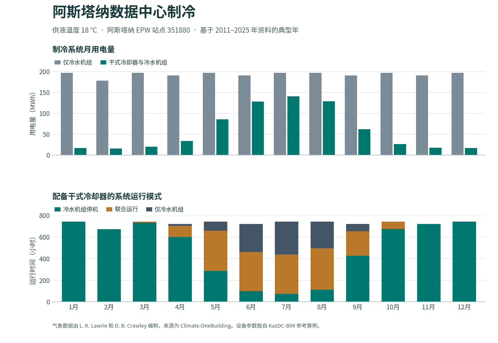

# KazDC 能源技术

[English](README.md) · [Қазақша](README.kk.md) · [Русский](README.ru.md) · 简体中文

[打开交互式平台](https://ktwyw.github.io/kazdc-energy-tech/regional-zh.html) · [哈萨克斯坦数据中心研究重点](https://ktwyw.github.io/kazdc-energy-tech/research-priorities-zh.html) · [单页会议简报（PDF）](reference/KazDC_Research_Brief_ZH.pdf)

**项目所属机构**为纳扎尔巴耶夫大学新材料与能源技术研究院（[INMET](https://inmet.nu.edu.kz/)）。**项目联系人**为 Yanwei Wang 博士 · [yanwei.wang@nu.edu.kz](mailto:yanwei.wang@nu.edu.kz)。

KazDC 能源技术是 KazDC-BIM 的交互式建模平台，用于研究哈萨克斯坦数据中心的节能技术。平台可离线运行。读者可以把同一套设备放在 21 座城市的气象条件下进行比较，也可以通过技术专题研究计算得到的能量流与学生或工程团队能够实际测量的量之间的关系。

解压项目后，在浏览器中打开[平台首页](regional-zh.html)。模型在本机计算，项目已包含全部气象数据。首页显示年制冷用电量、冷水机组可停机的小时数，并给出储雪供冷、余热回收和不间断电源（UPS）损耗的算例。月平均气温对比图位于[气象站档案](references-zh.html#weather-comparison)旁。区域制冷与余热回收模型覆盖哈萨克斯坦 17 个州的行政中心，以及阿斯塔纳、阿拉木图、奇姆肯特和埃基巴斯图兹。每座城市都有自己的 8,760 小时典型年。站点说明列出了原始资料涵盖的年份、气象站或再分析网格的位置，以及原始数据包。[区域气象数据](data/regions/README.zh.md)

平台的十个部分均提供英语、哈萨克语、俄语和简体中文版本。通过页首的**语言**菜单可切换同一页面的语言。区域制冷页会保留所选的模拟城市、气象对比城市和冷却液供液温度。

在首页试用 24 °C 供液温度，查看所选城市 7 月的变化。可在[两座城市逐月对比](regional-zh.html#city-comparison)中设置相同的供液温度，并下载两地的数据。**复制此算例**可复制模型设置、版本和公开链接。实测工作表中的记录保留在当前浏览器标签页。

| 专题 | 可以做什么 | 计算范围 |
|---|---|---|
| [哈萨克斯坦数据中心研究重点](research-priorities-zh.html) | 比较埃基巴斯图兹 7 月的两种供液温度，了解与一家运营方开展首次验证的研究安排 | [单页会议简报](reference/KazDC_Research_Brief_ZH.pdf)列出了预估人员投入、计量费用和验证方法 |
| [区域制冷](regional-zh.html#compare) | 在同一供液温度下比较 21 座城市的制冷用电量和冷水机组停机时数，导出年度或月度结果。 | IT 负荷固定为 1 MW，统计冷水机组、干式冷却器风机和循环泵的用电量 |
| [阿斯塔纳参考系统](astana-zh.html)及[计算方法](methods-zh.html) | 比较 49 个供液温度设定值，逐步核查某一小时的运行决策 | 阿斯塔纳详细参考算例 |
| [季节性储雪供冷](snow-zh.html) | 估算储雪规模，比较两种释冷策略，复现另一项持续 7 天、负荷为 5 kW 的模拟 | 阿斯塔纳储雪情景和另有文档记录的数值基准 |
| [余热回收](heat-zh.html) | 用直接换热或热泵辅助供热匹配一栋示例建筑随天气变化的热负荷 | 分别核算输送到建筑的热量、回收的 IT 热量和压缩机做功 |
| [UPS 损耗](power-zh.html) | 在 IT 输出功率相同的条件下比较两种运行效率 | UPS 端子的电力输入与输出 |
| [参考资料](references-zh.html) | 追溯气象资料、方程和实验方法的公开来源 | 包括站点档案、项目假设及参考结果 |
| [水循环回路实验](bench-zh.html) | 先填写预测，再输入相同时间段内的测量值，导出带正负号的能量平衡残差 | 稳态液态水测试段，附有明确标注的示例和空白实测记录表 |
| [绝热预冷辅助的干式冷却](technologies-zh.html?study=pad) | 设置夏季可用水量、湿帘效率及启用预冷的室外温度 | 逐时湿球温度限制、补水量、泵和风机用电，以及额外的整小时停机时间 |
| [芯片直冷冷板](technologies-zh.html?study=cold) | 运行示例或输入加热器及水循环回路测量值 | 液体带走的热量、冷板至进口冷却液的热阻，以及克服冷板压降所需的泵功率 |
| [间接利用室外空气冷却](technologies-zh.html?study=air) | 改变空气温度、换热器有效度、风机功率及结霜停用条件 | 带备用制冷的闭式显热换热系统，与参考水循环系统比较 |
| [丙二醇回路与变速泵](technologies-zh.html?study=glycol) | 比较几种给定浓度的丙二醇溶液、管道几何参数及更大的回路温升 | 在 1 MW 热负荷下的管路循环用电，以及室外气温低于溶液初始结冰温度的小时数 |
| [夜间冷水蓄冷](technologies-zh.html?study=tank) | 夜间利用干式冷却器的剩余能力蓄冷，下午按可用库存释冷 | 按时间顺序跟踪蓄冷量、输送用电及最大小时制冷需求 |
| [光伏与储能电池](technologies-zh.html?study=solar) | 设置水平光伏阵列与电池的规模、电池功率上限和备用电量 | 逐时光伏发电量、站点用电需求、电网购电量、弃光量和电池损耗 |

**课堂练习。** 先预测在 18 °C 供液时哪座城市的冷水机组可停机更久，再用两座城市的月度数据解释差异。在余热回收模型中，将用户所需的供热温度提高到直接换热可达到的上限以上，对照增加的压缩机用电与增加的供热量。在实验表中输入同一时段的质量流量和温度读数，检验能否复现预测的换热功率。

**重新构建与验证。** 运行 `python build.py` 可重新生成网页、参考 CSV 文件、自包含的项目下载包及可部署的 `dist/` 目录。运行 `python -m unittest discover -s tests -v` 和 `node --test` 进行测试。构建程序、模型与测试仅需 Python 3.10 或更高版本及 Node.js 18 或更高版本的标准功能。可选的参考图绘制脚本另需 Matplotlib。

如需根据各语种的最新文案和 7 月计算结果更新四份单页简报，可运行 `python build.py --refresh-briefs`。生成 PDF 需要 ReportLab、PyMuPDF 和 Noto Sans。常规构建会直接使用项目中已有的简报。

**检查气象数据和模型。** 计算测试覆盖 21 座城市和所有 49 个供液温度。在 18 °C 下，阿斯塔纳参考系统的年制冷用电量为 690.85 MWh，冷水机组可停机 5,888 小时。采用国际机场气象文件时，阿拉木图的相应结果为 808.84 MWh 和 5,382 小时。这份文件中若干夏季月份的气温低于机场当地观测值。气象说明给出了具体站点和月份的对比，以及太阳辐射时序检查。还可分别核查储雪余量、喷淋泵运行时间、按 UTC+5 民用时间调度的蓄冷运行、热泵可行性及电池能量平衡。[站点对比](data/regions/README.zh.md) · [技术模型的逐时输入](data/technology-weather/README.zh.md)

区域制冷和余热回收使用各月干球温度的出现频数。对相同温度下相互独立的逐时决策求和，这种表示与逐小时累加的结果相同。储雪模型按时间顺序读取阿斯塔纳天气。技术模型包含 21 座城市按时间顺序排列的干球温度、推算的湿球温度和水平面太阳辐射序列。各模型均可离线运行，并可连同当前设定导出结果。测量值保存在读者的浏览器内，可由读者自行导出。各专题列明了能量核算边界和参考配置。[区域数据说明](data/regions/README.zh.md) · [湿度、气压、太阳辐射及湿球温度计算](data/technology-weather/README.zh.md)

## 阿斯塔纳参考算例

**KazDC-BIM 参考算例，哈萨克斯坦阿斯塔纳。** 恒定的 1 MW IT 负荷在一个典型年释放 8,760 MWh 热量。当冷却液供液温度为 18 °C 时，干式冷却器排出 **6,987 MWh 热量（79.8%）**，冷水机组可停机 **5,888 小时（67.2%）**。计入风机与泵的用电后，制冷系统年用电量从 **2,321.4 MWh 降至 690.8 MWh**，降幅为 **70.2%**。

## 运行算例

**在浏览器中运行。** 解压项目，打开[阿斯塔纳制冷面板](astana-zh.html)。可将供液温度从 8 °C 调至 32 °C，步长为 0.5 °C。两幅月度图、数据表及可下载的 CSV 均随设定温度更新。该页面可离线运行。构建时由 Python 算好 49 组结果并嵌入页面。

打开[制冷模型与方法](methods-zh.html)，推导两个室外温度阈值，任选五条实际气象记录中的一条，逐步检查热量与电量平衡，并核对月度与年度总量。演算示例的供液温度为 18 °C。面板上的方法摘要则随当前供液温度更新。

储雪计算器沿用制冷面板上选定的供液温度。先在干式冷却能力不足时立即使用储雪，再将同样的储量留给最热的时段。比较储量耗尽的时间、新增的整小时停机时间，以及制冷系统省下的电量。[季节性储雪供冷](snow-zh.html)

三种储雪方式的比较用于估算保温容器、保温板围成的储雪设施和带覆盖层的雪堆到 7 月还能保留多少冰。另一项独立的七天 SnowCool 模拟考察在持续 5 kW 负荷下，冰水接触状况如何影响可提供的制冷功率。

### 储雪情景

中央制冷系统中干式冷却器的运行决策与原制冷面板采用同一套 Python 计算。从 6 月 1 日至 8 月 31 日，增设的融雪水回路每小时可替代的冷量以该小时剩余的冷水机组负荷为上限。初始储量独立于气象数据设定。输入包括压实后体积、冰当量密度、入夏时的可利用比例、在当前供液温度下可达到的换热功率、储雪回路泵的耗电功率，以及按初始冰质量计的可选额外搬运用电量（每吨）。温度触发策略按时间先后检查符合温度条件的小时。释冷需同时满足有用冷需求、设备可用及库存充足这三个条件。

示例设置为 18 °C 供液、储雪体积 4,000 m³、每立方米含 550 kg 冰当量、可利用比例 70%。6 月初的可用蓄冷量为 142.66 MWh。按换热器 500 kW、泵耗电 5 kW 计算，在计入搬运耗电前，制冷系统全年额外节电 34.24 MWh。若立即使用储雪，冷水机组可额外停机 126 个完整小时，储量于 6 月 18 日耗尽。若室外温度达到 25 °C 才启用储雪，储量可维持到 7 月 13 日。两种策略下，典型年的冷水机组峰值冷负荷均为 1 MW。当两种策略都用尽库存时，由于采用相同的固定性能系数（COP）及单位冷量泵耗电，节电量相同。这些是设定情景的结果。要估算具体场地的表现，需测量可回收雪量、热损失、泵功率及换热器实际达到的功率。

设施模型以一个系数表示可利用比例，并将有效换热功率视为常数。三种储雪方式按假设的平均得热功率计算 4 月 1 日至 7 月 1 日的储量变化。独立的 5 kW 七天模拟沿用原研究中冰水接触与换热器随状态变化的耦合计算。浏览器可导出包含 12 个月结果、年度总量及当前输入的 CSV 文件。输入来源与模拟时序提取方法见[数据说明](data/README.zh.md)。

**使用 Python。** 在项目目录下使用 Python 3.10 或更高版本运行以下命令。模型、数据工具、网页构建程序和测试均使用标准库。

```bash
python cooling.py
python cooling.py --supply 24 --output results_24C
python -m unittest discover -s tests -v
```

第二条命令写出逐时、月度和年度 CSV。命令行接受任意有限的供液温度值，研究时应选用所考察系统运行范围内的数值。要比较不同设备，复制 [case.json](case.json)，修改副本，并通过 `--case` 指定该文件。修改参考输入后，运行 `python build.py` 可重建面板及随附的默认输出。

## 供液温度如何影响结果？

| 供液温度 | 仅用冷水机组的耗电量 | 干式冷却器与冷水机组联合运行的耗电量 | 制冷节电率 | 冷水机组停机时间 | 干式冷却器排出的 IT 热量占比 |
|---:|---:|---:|---:|---:|---:|
| 12 °C | 2,321.4 MWh | 991.6 MWh | 57.3% | 4,802 h | 65.6% |
| 18 °C | 2,321.4 MWh | 690.8 MWh | 70.2% | 5,888 h | 79.8% |
| 24 °C | 2,321.4 MWh | 429.0 MWh | 81.5% | 7,226 h | 91.6% |

在 18 °C 供液条件下，1 月、2 月、11 月和 12 月的冷水机组整月无需运行。7 月有 744 小时，其中停机 74 小时，另有 365 小时由干式冷却器与冷水机组联合运行。全年有 5,888 小时仅用干式冷却器、1,893 小时联合运行、979 小时仅用冷水机组。干式冷却器在联合运行时也分担热负荷，因此其排热量占比高于其独立承担全部负荷的小时数占比。



[在面板中探索图表](astana-zh.html#charts)

## 系统边界与假设

IT 设备向闭式冷却液回路释放恒定的显热。回流冷却液先经过干式冷却器，余下的热量由冷水机组移除。两种系统均满足相同的热负荷与供液设定温度。室外换热器使用空气干球温度计算，无蒸发冷却环节。

| 假设 | 参考值 | 含义 |
|---|---:|---|
| IT 热负荷，$Q$ | 1,000 kW 热功率 | 两种系统的每一小时保持相同负荷 |
| 供液温度，$T_s$ | 18 °C | 读者可调节的制冷系统出口冷却液温度 |
| 回液与供液温差，$\Delta T$ | 6 K | 恒定流量和热负荷给出 $T_r=T_s+\Delta T$ |
| 干式冷却器额定逼近温差，$A$ | 5 K | 设计风量、满负荷下，出口冷却液温度减去进口空气温度 |
| 冷水机组性能系数，COP | 4.0 | 供冷功率除以整套机组（含冷凝侧辅机）的电功率 |
| 干式冷却器风机全速功率，$F$ | 25 kW 电功率 | 平均风机功率与该小时内的开启时间占比成正比 |
| 共用循环泵，$P_p$ | 15 kW 电功率 | 两种系统全年均计入该泵用电 |

所有供液温度使用同一个全速风机有效传热系数。算例比较同一套设备在给定控制策略和气候条件下的运行效果。在*设备参数文件*中改变 IT 负荷时，干式冷却器的额定容量也随新的参考负荷调整。针对具体系统，应获取额定换热功率、风机与泵功率、冷却液流量、逼近温差及冷水机组性能图。

### 逐时热平衡

在额定工况下，当 $T_a=T_s-A$ 时，干式冷却器恰好能独立承担全部冷负荷，其中 $T_a$ 为室外干球温度。风机全速时的有效传热系数为 $G=Q/(\Delta T+A)$，本算例为 90.91 kW/K。冷却液和空气流量固定时，作出运行决策前的全速换热能力与可用干冷功率分别为

$$
Q_{\mathrm{cap}}=G\max(0,T_r-T_a),\qquad
Q_d=\min(Q,Q_{\mathrm{cap}}).
$$

当换热能力大于零时，所需风机运行时间占比为 $d=Q_d/Q_{\mathrm{cap}}$。干式冷却器仅承担部分冷负荷时，风机会连续运行，$d=1$。在更冷的小时内，单速风机间歇运行，回路在该小时内缓冲负荷。假设风机关闭时排热量为零。两种待选运行方式的电功率分别为

$$
P_{\mathrm{hybrid}}=P_p+dF+\frac{Q-Q_d}{\mathrm{COP}},\qquad
P_{\mathrm{base}}=P_p+\frac{Q}{\mathrm{COP}}.
$$

控制器选择耗电功率较低的方式。两者相等或干式冷却器换热能力为零时，均旁通干式冷却器。对于每种实际运行方式，热平衡均为 $Q_d+Q_{\mathrm{chiller}}=Q$。逐小时的功率乘以一小时，再按月或年求和，即得月度或年度能量。

以 18 °C 供液为例，可手算验证两种工况。室外温度为 2 °C 时，全速风机对应的换热能力为 2,000 kW。风机运行半小时即可满足当小时的热负荷，系统平均耗电功率为 27.5 kW。室外温度为 18.5 °C 时，全速换热能力降至 500 kW。风机连续运行，冷水机组移除剩余的 500 kW 热量，系统总耗电功率为 165 kW。

| 供液温度 18 °C | 运行方式 | 电功率计算 |
|---|---|---|
| 室外温度 ≤ 13 °C | 冷水机组停机，干式冷却器承担全部负荷 | 共用泵 + 间歇运行的风机 |
| 13 °C < 室外温度 < 22.9 °C | 干式冷却器辅助冷水机组 | 共用泵 + 全速风机 + 承担剩余负荷的冷水机组 |
| 室外温度 ≥ 22.9 °C | 旁通干式冷却器 | 共用泵 + 冷水机组 |

回液温度为 24 °C 时，室外空气温度达到 24 °C，干式冷却器全速运行的换热能力便降为零。控制器会提前在 22.9 °C 时旁通干式冷却器，因为 COP 为 4 时，替代 100 kW 冷负荷仅能节省 25 kW 的冷水机组输入功率，恰好等于风机功率。因此，在 18 °C 参考工况下，干式冷却器不再产生净节电效益的温度范围比仅按温度启停的规则所显示的更宽。

### 如何解读结果

制冷系统用电包括冷水机组、干式冷却器风机及共用泵。在 18 °C 工况下，联合系统全年分别消耗 443.28、116.16 和 131.40 MWh 电能。IT 设备用电、室内空气处理、UPS 损耗及其他设施负荷均在比较范围之外。70.2% 的节电率仅针对上述制冷系统边界。

由于模型将 COP 设为常数，仅使用冷水机组的基准用电量不随供液温度变化。实际机组的 COP 会随制冷温升（冷凝与蒸发温度之差）和部分负荷工况变化。模型采用固定逼近温差和逐时启停风机，简化了流体物性、换热器污垢、最短运行时间、防冻措施及控制逻辑。气象文件是用来估算能耗的代表年。场地设计和韧性分析还需考虑设备工作范围、防冻策略、极端工况和多年气象资料。页面上的供液设定值是研究输入。

即使同为 18 °C 供液，设备假设也会影响结果。按 3 K 额定逼近温差选型时，冷水机组可停机 **6,367 小时**，联合系统耗电 **625.2 MWh**。当逼近温差变为 7 K 时，结果为 **5,461 小时**和 **755.4 MWh**。每次比较仅改变设备输入文件中的逼近温差。对于具体场地，可使用预期负荷下的实测或制造商额定逼近温差。

## 气象数据、输出与复现

[随附的逐时 CSV](data/astana_hourly.csv)包含模型所用的全部 8,760 个干球温度值。[数据说明](data/README.zh.md)列出了原始 EnergyPlus 气象文件、来源年份、站点元数据、署名信息、校验和与重新生成数据的命令。气象文件中的数值与设备模拟结果分别存放。

| 文件 | 用途 |
|---|---|
| [reference/hourly.csv](reference/hourly.csv) | 核对 18 °C 下每小时的调度、冷负荷、风机运行时间占比及各部件用电 |
| [reference/monthly.csv](reference/monthly.csv) | 18 °C 下 12 个月的能量与运行时数 |
| [reference/annual.csv](reference/annual.csv) | 18 °C 下的年度总量，保留六位小数 |
| [reference/supply_sweep.csv](reference/supply_sweep.csv) | 面板全部 49 个供液温度设定值的年度指标 |
| [cooling.py](cooling.py) · [case.json](case.json) | 运行决策计算和可编辑的设备参数 |
| [计算方法](methods-zh.html) · [methods.py](methods.py) | 详细方法、基于真实气象小时的算例，以及由参考模型计算的设备参数敏感性 |
| [储雪页面](snow-zh.html) · [snow_inputs.py](snow_inputs.py) · [web/snow-model.js](web/snow-model.js) | 夏季储雪调度及按目标反算储量、制冷系统用电量、三种储雪方式的剩余冰量对比和七天模拟复现 |
| [web/](web/) · [build.py](build.py) | 网页模板、离线图表及一键重建 |
| [tests/](tests/) | 手算工况、数据完整性、热量和电量核算及独立的温度阈值小时计数 |

在输出文件中，`_kw_th` 与 `_mwh_th` 分别表示热功率和热量，后缀 `_e` 表示用电。在逐时文件中，`dry_only` 表示冷水机组停机，`assisted` 表示两套设备联合运行，`chiller_only` 表示旁通干式冷却器。由于每条记录的时长为一小时，逐时 kW 数值之和在数值上等于以 kWh 计的能量。年度行的百分比按年度总量计算。

网页可直接从本地文件打开，也可通过静态服务器提供。在 GitHub Pages 中选择 `main` 分支的根目录发布，其中已包含 `index.html` 和 `source.zip`。重新构建后，将更新的 HTML 页面、参考文件和 `source.zip` 一并提交。如果 GitHub 用户名或仓库名变更，请更新 `platform_build.py` 中的 `PUBLIC_SITE` 及各语种说明开头的网址，再运行 `python build.py --refresh-briefs`，以更新算例分享链接和 PDF 中的链接。运行 `python build.py --downloads exports` 可生成采用独立分发文件名的便携 HTML。请将这些文件放在同一目录中，以便页面间导航。如需用 Matplotlib 重新绘制本指南的图，请运行 `python plot_reference.py --language zh`。绘制中文图还需要支持中文的字体，例如 Noto Sans CJK。利用随附 CSV 即可离线重建全部网页。安装 Node.js 后，运行 `node --test tests/snow.test.cjs` 可检验浏览器的储雪调度与能量平衡。

### 来源

- Linda K. Lawrie 和 Drury B. Crawley（2026），*Development of Global Typical Meteorological Years (TMYx)*。[Climate.OneBuilding 资料说明](https://climate.onebuilding.org/sources/default.html) · [哈萨克斯坦气象文件](https://climate.onebuilding.org/WMO_Region_2_Asia/KAZ_Kazakhstan/index.html)
- *EnergyPlus Engineering Reference* 提供更详细的单速和双速干式流体冷却器模型。本研究采用在一个额定点标定的全速风机传热系数及上文的运行决策方程。[EnergyPlus 流体冷却器参考资料](https://bigladdersoftware.com/epx/docs/24-2/engineering-reference/cooling-towers-and-evaporative-fluid-coolers.html#one-and-two-speed-fluid-coolers)
- EnergyPlus 气象数据字典规定了输入字段及缺测值的表示方法。[EPW 数据字典](https://bigladdersoftware.com/epx/docs/24-2/auxiliary-programs/energyplus-weather-file-epw-data-dictionary.html)
